# Stone Burst: Ekranlar

Sürüm 1.0.0 · 2026-11-11 · Görseller: `ekranlar/` (oyunun kendisinden yakalandı, 1080×1920'den 720 piksele küçültüldü)

Bu belge oyundaki her ekranı ve kartı tek tek anlatır: ne zaman açılır, üzerinde ne vardır, hangi düğme ne yapar. Kuralların ve sayıların ayrıntısı [OYUN_MANTIGI.md](OYUN_MANTIGI.md) belgesindedir.

**Yakalama koşulları:** Türkçe arayüz, örnek kayıt (genellikle 12 bölüm bitmiş, 30 yıldız), sabit tarih 2026-11-08, ülke TR. Yeniden üretmek için `tools/unity.ps1 capture-vr1` komutu çalıştırılır. Çıktı PNG olur; JPG'ye çevirip küçültmek elle yapılır.

---

## İçindekiler

1. [Ekran akışı](#1-ekran-akışı)
2. [Açılış](#2-açılış)
3. [Harita (ana sayfa)](#3-harita-ana-sayfa)
4. [Kalpler](#4-kalpler)
5. [ZPE paneli](#5-zpe-paneli)
6. [Günlük Bulmaca](#6-günlük-bulmaca)
7. [Koleksiyon (Taşlar)](#7-koleksiyon-taşlar)
8. [Sıralama](#8-sıralama)
9. [Deneme Bölümleri](#9-deneme-bölümleri)
10. [Oyun ekranı](#10-oyun-ekranı)
11. [Oyun içi kartlar ve yardımlar](#11-oyun-içi-kartlar-ve-yardımlar)
12. [Sonuç kartları](#12-sonuç-kartları)
13. [Ayarlar](#13-ayarlar)
14. [Reklam ekranları](#14-reklam-ekranları)
15. [Gözlenen sorunlar](#15-gözlenen-sorunlar)

---

## 1. Ekran akışı

```text
Açılış (OFIGAME logosu)
   │
   ▼
Harita (ana sayfa) ──────────────┬───────────────┬──────────────┐
   │ alt menü: Harita · Günlük · Taşlar          │              │
   │                              │              │              │
   ├─ bölüm düğümü → Bölüm kartı → OYUN EKRANI   │              │
   │                                │            │              │
   │                 ┌──────────────┼────────────┤              │
   │                 ▼              ▼            ▼              │
   │             Zafer kartı    Kayıp kartı   Duraklat          │
   │                                                            │
   ├─ kalp kapsülü → Kalpler kartı                              │
   ├─ ZPE düğmesi → ZPE paneli                                  │
   ├─ Sıralama düğmesi → Sıralama → (i) Sıralama puanı          │
   ├─ kilitli taş rozeti → Koleksiyon                           │
   ├─ (Deneme listesi: haritadan kaldırıldı, karar 2026-11-08)    │
   └─ dişli → Ayarlar → Dil seçimi                              │
                                                                │
Günlük ──→ Günlük Bulmaca kartı → (reklam) → günlük oyun ekranı ┘
Taşlar ──→ Koleksiyon → taş vitrini (3D)
```

- Alt menüde üç sekme vardır: **Yolculuk** (2026-11-11'e kadar adı "Harita"ydı), **Günlük**, **Taşlar**. Oyun ekranında alt menü görünmez.
- 2026-11-11 değişiklikleri:
  - Seçili sekmenin ikonu yavaşça büyüyüp küçülür.
  - Günlük kartı açıkken Günlük sekmesi seçili görünür ve alt menü kartın üstünde kalır.
  - Yolculuk sekmesi Günlük kartını kapatır.
  - Ekran görüntüleri bu değişikliklerden önce alındı.
- Ayarlar her ana ekranın sağ üstündeki dişliyle açılır.
- Kartların (modal) hepsi aynı kalıpla çizilir: krem kart, altın çerçeve, sağ üstte kapat (×) düğmesi, altta ana düğme (koyu turkuaz) ve ikincil düğmeler (krem).

---

## 2. Açılış

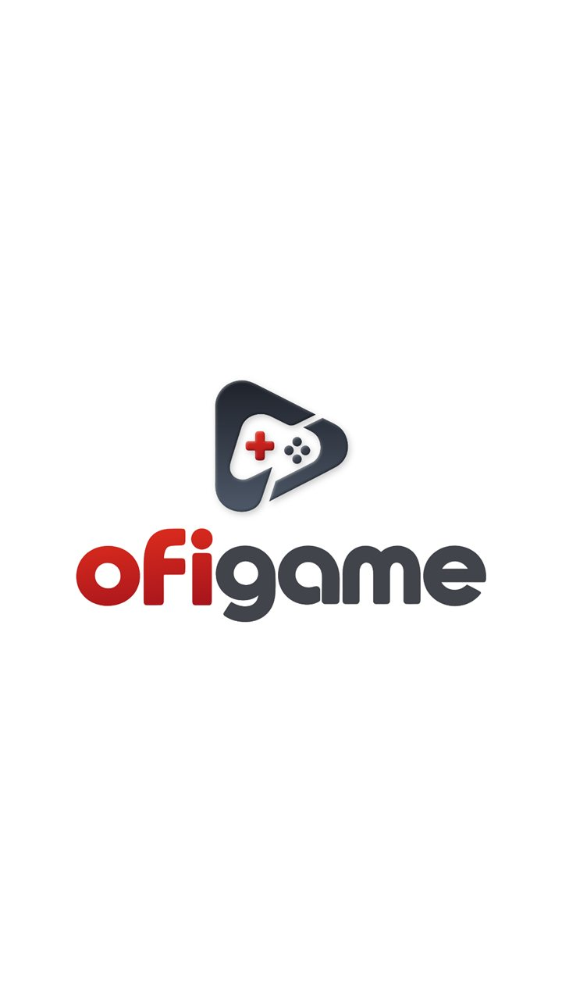

- **Ne zaman:** uygulama her açıldığında.
- **Ne var:** beyaz zemin üstünde OFIGAME logosu. Yaklaşık 1,6 saniye görünür. Oyun sahnesi bu sırada arkada yüklenir.
- **Sonra:** harita açılır. Hesap varsa açılışta sessiz giriş denenir (iOS'ta Game Center, Android'de Play Games) ve buluttaki kayıt okunur.

---

## 3. Harita (ana sayfa)

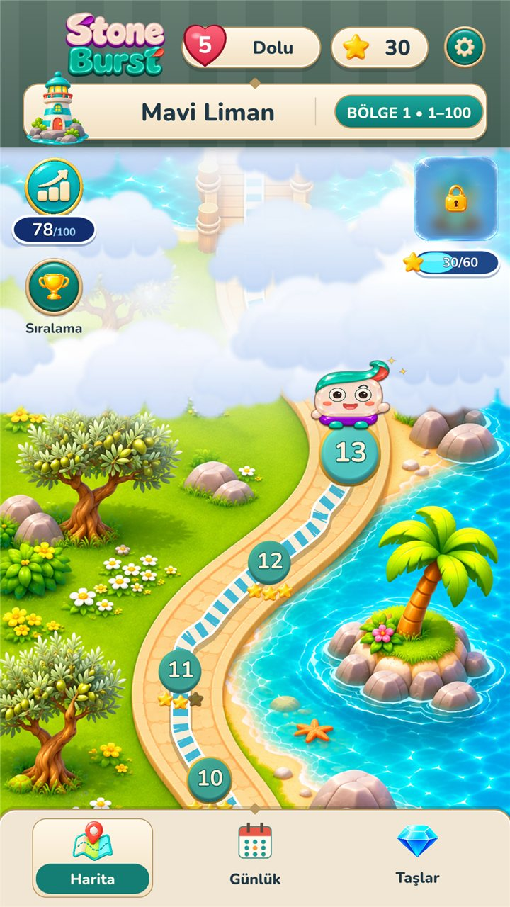 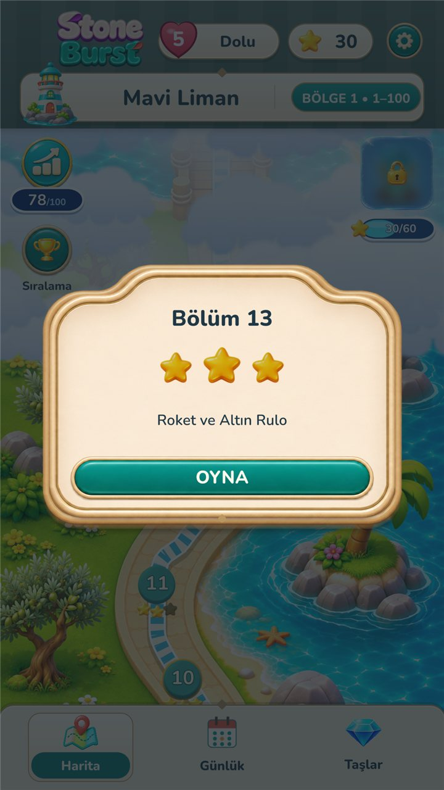

**Üst çubuk (soldan sağa)**

| Öğe | Anlamı / eylem |
|---|---|
| Stone Burst logosu | Yalnız görsel. |
| Kalp kapsülü | Kalp sayısı ve durum ("Dolu" ya da bir sonraki kalbe kalan süre). Dokununca **Kalpler** kartı açılır. |
| Yıldız kapsülü | Toplam yıldız (bölüm yıldızları + günlük bulmaca yıldızları). |
| Dişli | Ayarlar. |

**Bölge kartı:** bölge simgesi (örnekte deniz feneri), bölge adı (**Mavi Liman**) ve aralık rozeti (**BÖLGE 1 • 1–100**). Harita kaydırıldıkça görünen bölgeye göre güncellenir.

**Sol sütun**
- **ZPE düğmesi** (yükselen grafik simgesi) ve altında puan (örnekte **78/100**): dokununca ZPE paneli açılır.
- **Sıralama düğmesi** (kupa): Sıralama ekranını açar.

**Sağ üst:** sıradaki **kilitli koleksiyon taşı** (bulanık, asma kilitli) ve altında ilerleme çubuğu (örnekte **30/60** yıldız). Dokununca Koleksiyon açılır.

**Yol:**
- Bölümler kıvrımlı bir yol üstünde numaralı düğümlerdir. Kazanılmış düğümün altında 1–3 yıldız görünür.
- Mevcut bölümün üstünde **maskot** zıplar (örnekte 13).
- Açılmamış bölümler numarasızdır ve bulut örtüsünün altında kalır. İlerledikçe bulutlar açılır.
- Harita üç bölge temasından geçer (sahil, bahçe, çöl). Bölgeler arasında nehir ve köprü vardır.
- Harita kaydırılıp mevcut bölümden uzaklaşılınca "bölümüme dön" düğmesi çıkar.

**Bölüm kartı** (sağdaki görsel):
- Bir düğüme dokununca açılır. Üzerinde bölüm numarası, kazanılmış yıldızlar ve kısa bir not vardır (örnekte "Roket ve Altın Rulo").
- **OYNA** düğmesi oyun ekranını açar.
- Kalp yoksa bölüm açılmaz, onun yerine "Kalplerin bitti" kartı çıkar (21. bölümden itibaren).

---

## 4. Kalpler

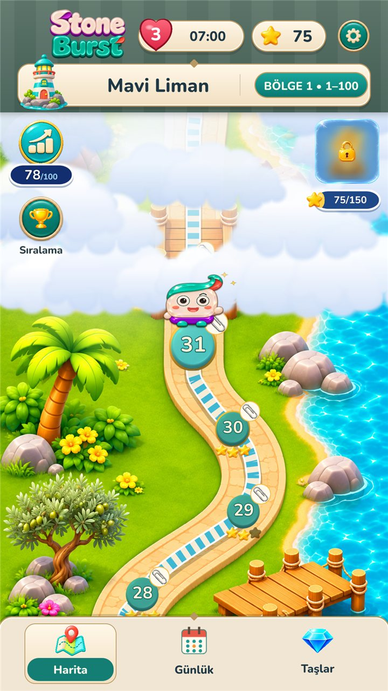 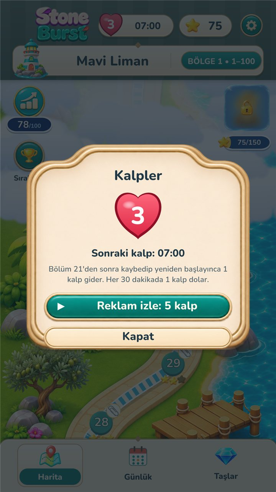 

| Ekran | Ne zaman | İçerik |
|---|---|---|
| Harita, eksik kalp | Kalp 5'ten azken | Kapsülde kalp sayısı (örnekte 3) ve geri sayım (07:00). |
| **Kalpler** kartı | Kalp kapsülüne dokununca | Büyük kalp ve sayı, "Sonraki kalp: 07:00", kural metni ("Bölüm 21'den sonra kaybedip yeniden başlayınca 1 kalp gider. Her 30 dakikada 1 kalp dolar."). Düğmeler: **Reklam izle: 5 kalp**, **Kapat**. |
| **Kalplerin bitti** kartı | Kalp 0'ken bölüm açılmak istenince | Aynı kalıp, kalp 0. Reklam izlenirse 5 kalp dolar ve bölüm açılır. |

---

## 5. ZPE paneli

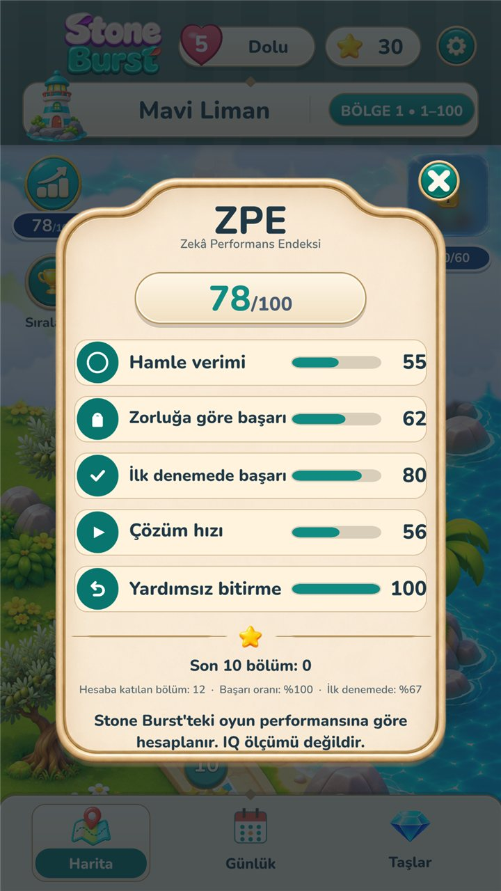

- **Ne zaman:** haritada ZPE düğmesine dokununca.
- **ZPE (Zekâ Performans Endeksi):** 0–100 arası bir oyun performans puanı. Panelin altında "IQ ölçümü değildir." uyarısı yazar.
- **Beş bileşen**, her biri çubuk ve 0–100 değer:
  - Hamle verimi
  - Zorluğa göre başarı
  - İlk denemede başarı
  - Çözüm hızı
  - Yardımsız bitirme
- **Alt satır:** son 10 bölümdeki değişim, hesaba katılan bölüm sayısı, başarı oranı ve ilk denemede başarı oranı.
- Hesap yöntemi için bkz. OYUN_MANTIGI.md → ZPE.

---

## 6. Günlük Bulmaca

### 6.1 Giriş kartı

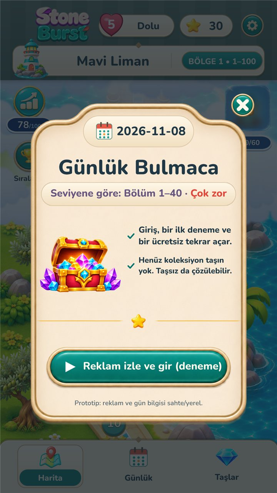 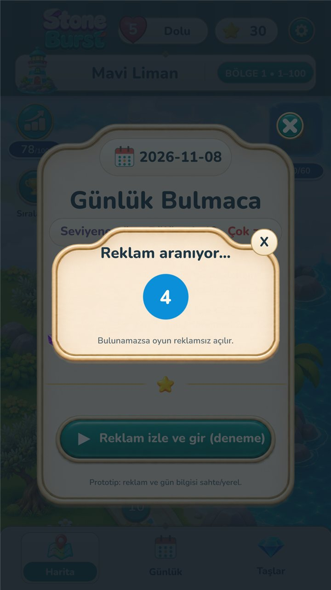 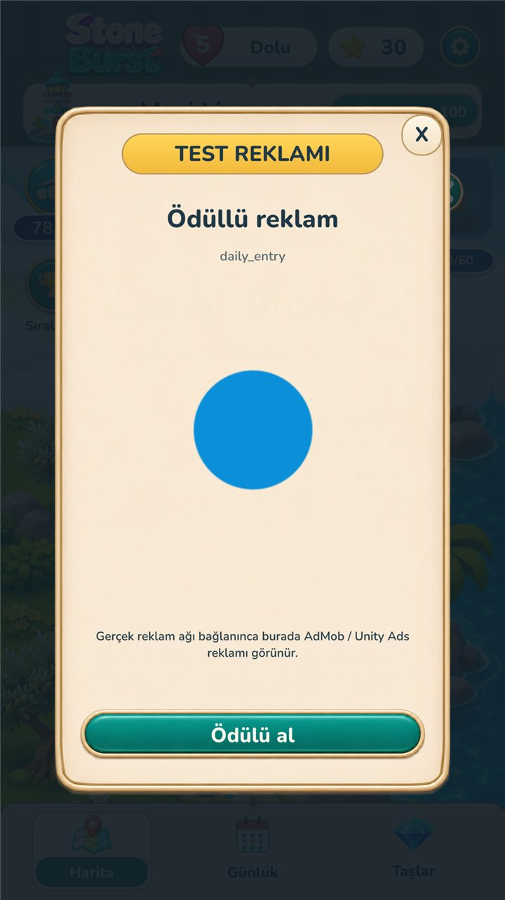

- **Ne zaman:** alt menüde **Günlük** sekmesine dokununca. Haritanın üstünde kart olarak açılır.
- **Üst kısım:** tarih rozeti, "Günlük Bulmaca" başlığı ve zorluk satırı (örnekte "Seviyene göre: Bölüm 1–40 · Çok zor").
- **Maddeler:**
  - Girişin bir ilk deneme ve bir ücretsiz tekrar açtığı.
  - Seçili koleksiyon taşı. Taş yoksa "Henüz koleksiyon taşın yok. Taşsız da çözülebilir."
- **Ana düğme:** **Reklam izle ve gir**. Reklam önce aranır ("Reklam aranıyor…", 5 saniyelik sayaç; bulunamazsa oyun reklamsız açılır), sonra ödüllü reklam oynar.
- Günlük bulmaca günde bir kez çözülebilir. Çözüldükten sonra kart "tamamlandı" haline geçer (6.4).

### 6.2 Günlük oyun ekranı

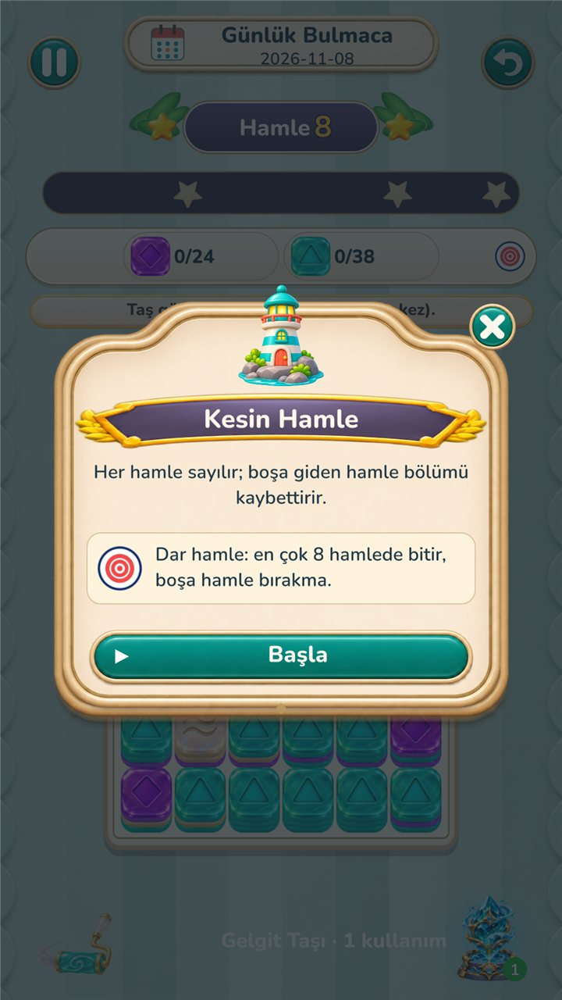

- Normal oyun ekranının aynısıdır, iki farkı var:
  - Üstte **"Günlük Bulmaca" + tarih** başlığı vardır.
  - Altta seçili **koleksiyon taşı** durur (örnekte "Gelgit Taşı · 1 kullanım"). Taşın gücü denemede bir kez kullanılır.
- Her günlükte o günün **kural kartı** gösterilir (örnekte Kesin Hamle).
- `28_gunluk_kural_karti.jpg` aynı görüntüdür.

### 6.3 Günlük sonuçları

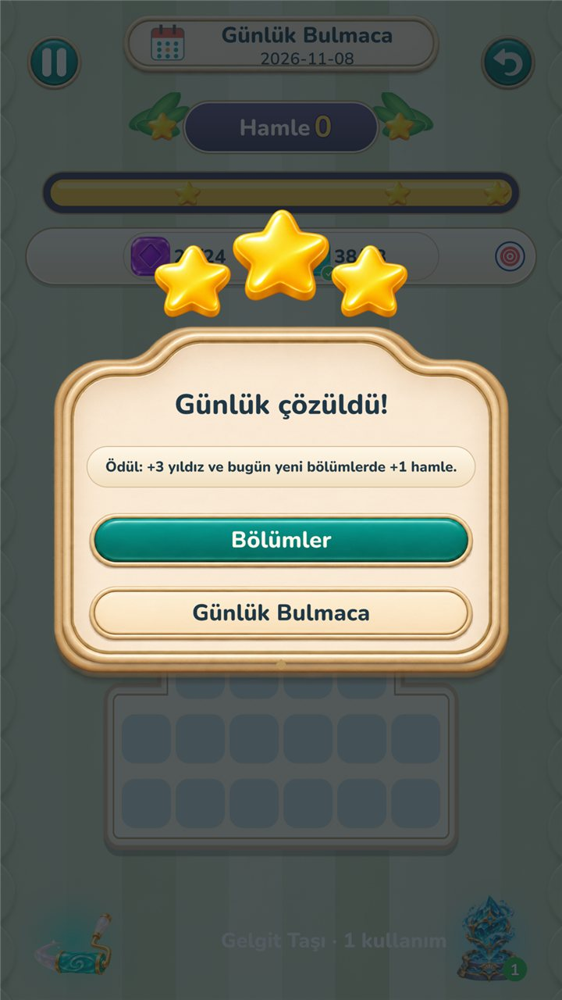 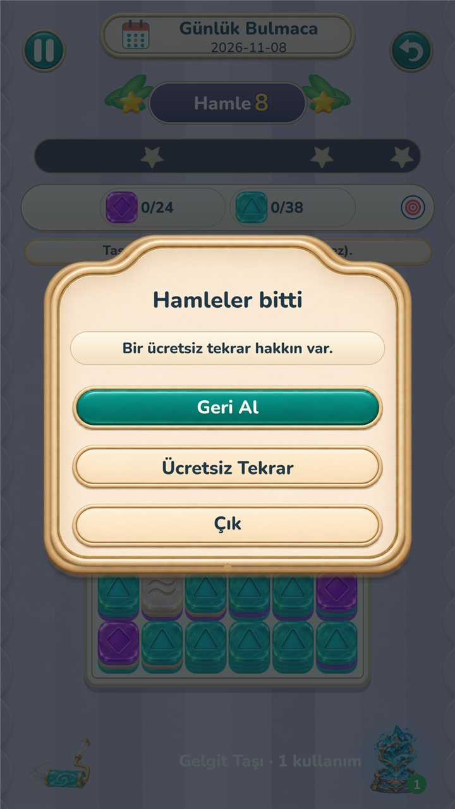 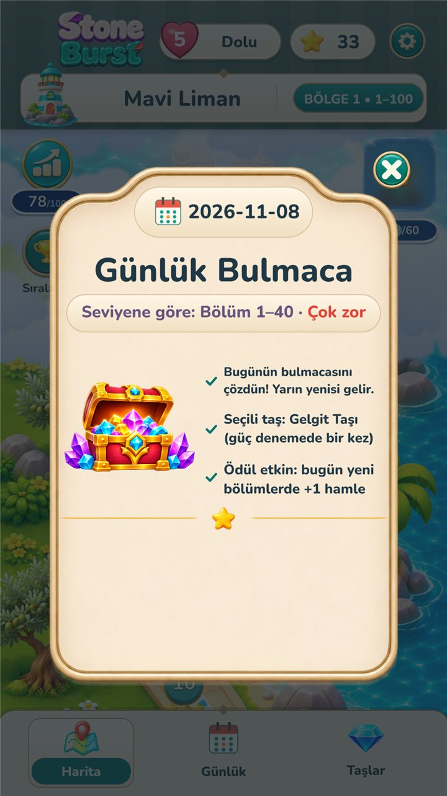

| Kart | İçerik | Düğmeler |
|---|---|---|
| **Günlük çözüldü!** | 1–3 yıldız; ödül satırı "+3 yıldız ve bugün yeni bölümlerde +1 hamle." | Bölümler, Günlük Bulmaca |
| **Hamleler bitti** (günlük) | "Bir ücretsiz tekrar hakkın var." | Geri Al, Ücretsiz Tekrar, Çık |
| **Tamamlandı** (giriş kartı) | "Bugünün bulmacasını çözdün! Yarın yenisi gelir.", seçili taş, etkin ödül (+1 hamle) | Yalnız kapat |

---

## 7. Koleksiyon (Taşlar)

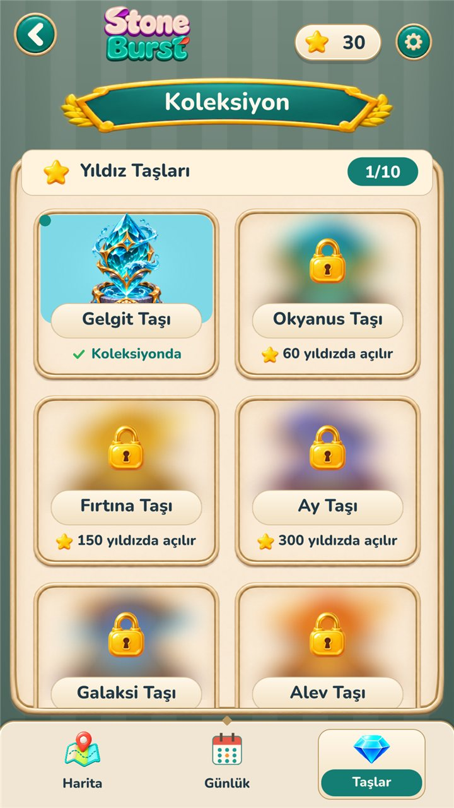 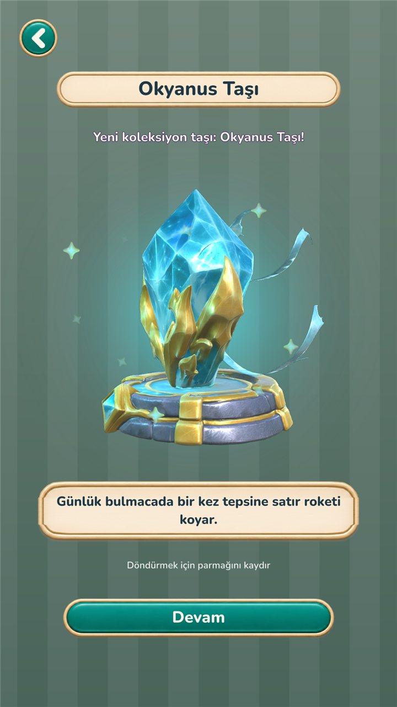

**Koleksiyon ekranı:**
- **Ne zaman:** alt menüde **Taşlar** sekmesine ya da haritadaki kilitli taş rozetine dokununca.
- **Başlık:** "Yıldız Taşları" ve sayaç (örnekte **1/10**).
- **Kartlar:** her taş bir kart. Açılmış taşın resmi görünür ve altında "✓ Koleksiyonda" yazar. Kilitli taş bulanık ve asma kilitlidir, altında açılma eşiği yazar ("60 yıldızda açılır", "150", "300"…).
- Önce 10 **yıldız taşı** (Gelgit, Okyanus, Fırtına, Ay, Galaksi, Alev ve dört taş daha), sonra 2 **efsanevi taş** listelenir. Veride 10 gizli hazine de var; hazine bulma bölümlere bağlanana kadar koleksiyonda gösterilmez (bkz. OYUN_MANTIGI.md §12).

**Taş vitrini (3D):**
- **Ne zaman:** yeni taş kazanılınca kendiliğinden ya da koleksiyonda bir taşa dokununca.
- **İçerik:** taşın adı, "Yeni koleksiyon taşı: …!" yazısı, dönen 3D model ve taşın gücü (örnekte "Günlük bulmacada bir kez tepsine satır roketi koyar.").
- Parmakla kaydırınca model döner. **Devam** ile kapanır.

---

## 8. Sıralama

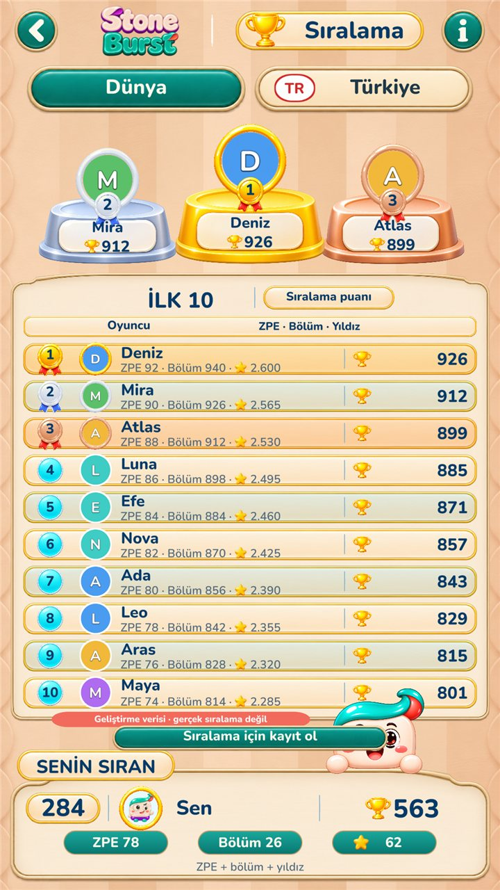 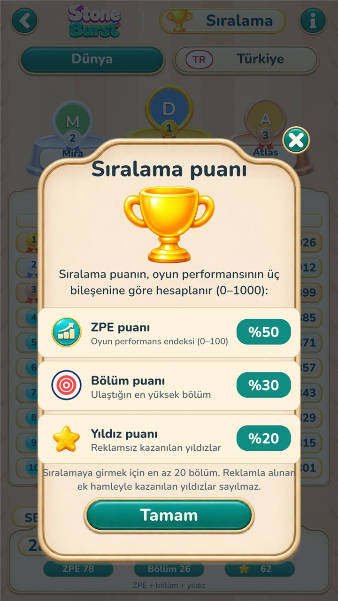

> Görseldeki oyuncular **geliştirme örnek verisidir**; ekranda kırmızı "Geliştirme verisi · gerçek sıralama değil" etiketi görünür. Gerçek sıralama Firebase'den gelir.

**Sıralama ekranı:**
- **Üst kısım:** geri düğmesi, logo, "Sıralama" başlığı, bilgi (i) düğmesi.
- **Kapsam düğmeleri:** **Dünya** ve **ülke** (örnekte TR Türkiye).
- **Kürsü:** ilk üç oyuncu (altın, gümüş, bronz), baş harfli rozet ve sıralama puanı.
- **İLK 10 listesi:** sıra, ad, ZPE · Bölüm · Yıldız ve sıralama puanı.
- **"Sıralama için kayıt ol":** hesap girişi yoksa görünür ve Game Center / Play Games girişini açar.
- **SENİN SIRAN:** oyuncunun sırası, puanı ve ZPE / Bölüm / Yıldız değerleri.

**Sıralama puanı kartı ((i) düğmesi):**
- Puan 0–1000 arasıdır ve üç bileşenden oluşur: **ZPE %50**, **Bölüm %30** (ulaşılan en yüksek bölüm), **Yıldız %20** (reklamsız kazanılan yıldızlar).
- Alt not: "Sıralamaya girmek için en az 20 bölüm. Reklamla alınan ek hamleyle kazanılan yıldızlar sayılmaz."

---

## 9. Deneme Bölümleri

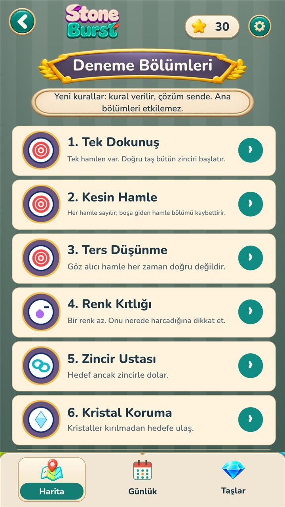 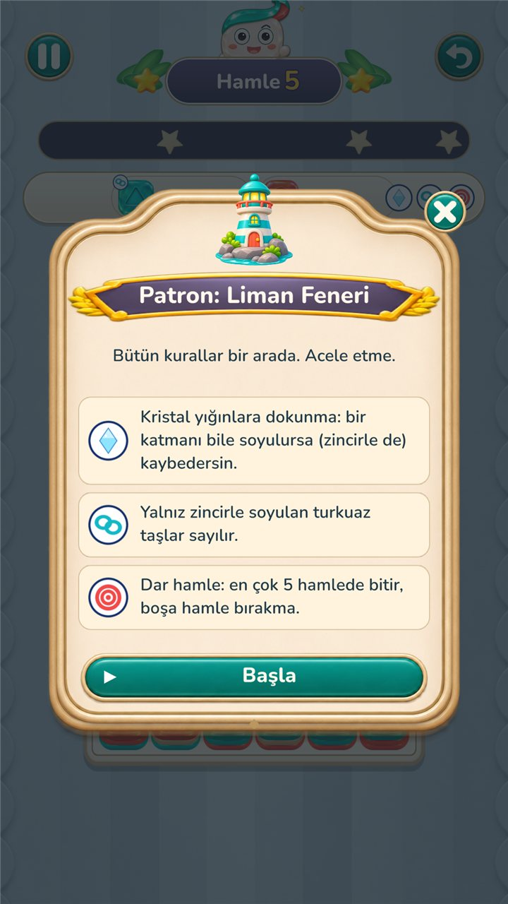 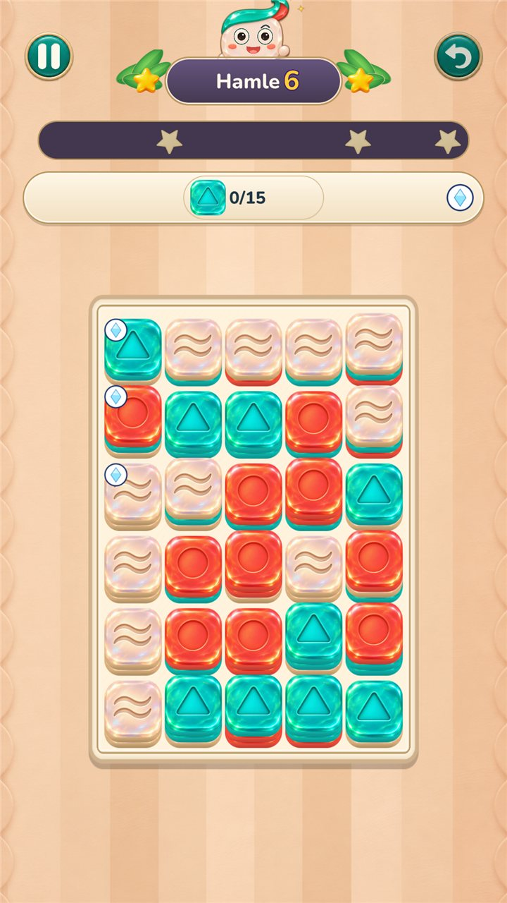

**Deneme listesi:**
- **Ne zaman:** şu an oyuncuya açık değil. Bölüm türleri ana bölümlere taşınınca Deneme düğmesi haritadan kaldırıldı (onaylı karar, 2026-11-08). Liste ve 10 bölüm kodda duruyor; görsel yakalama aracıyla doğrudan açıldı.
- Başlık "Deneme Bölümleri", altında "Yeni kurallar: kural verilir, çözüm sende. Ana bölümleri etkilemez."
- Her satırda bir bölüm türü bulunur: simge, ad, tek cümlelik kural ve **›** düğmesi. Sıra:
  1. Tek Dokunuş
  2. Kesin Hamle
  3. Ters Düşünme
  4. Renk Kıtlığı
  5. Zincir Ustası
  6. Kristal Koruma
  7. …

**Deneme kural kartı:** denemeye girince açılır. Örnekte **Patron: Liman Feneri**, "Bütün kurallar bir arada. Acele etme." ve kural satırları:
- Kristal yığınlara dokunma.
- Yalnız zincirle soyulan turkuaz taşlar sayılır.
- Dar hamle: en çok 5 hamle.

**Deneme tahtası:**
- Normal oyun ekranıdır. Kristal yığınların sol üstünde elmas işareti vardır.
- Hedef kartının sağında kural simgesi (örnekte kristal) durur. Dokununca kural cümlesi görünür.

**Deneme kaybı:** `32_deneme_kayip_karti.jpg` karttır, "Hamleler bitti · Hamlen kalmadı." yazar. Düğmeler: **Tekrar Dene**, **Deneme listesi**. Reklam ve ipucu seçeneği yoktur.

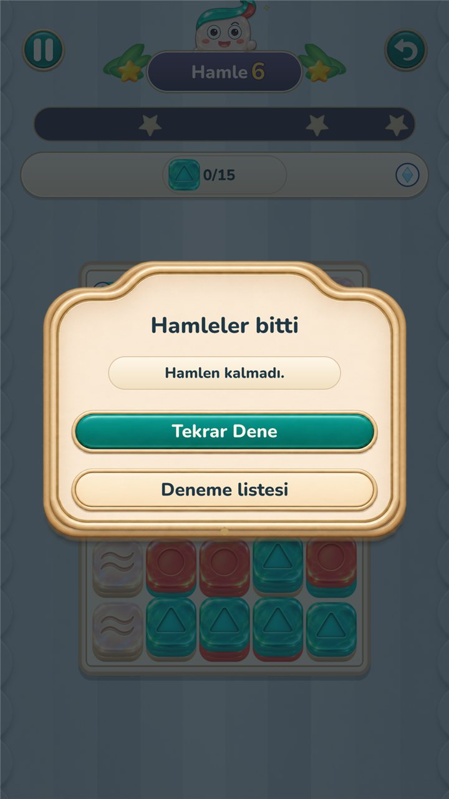

---

## 10. Oyun ekranı

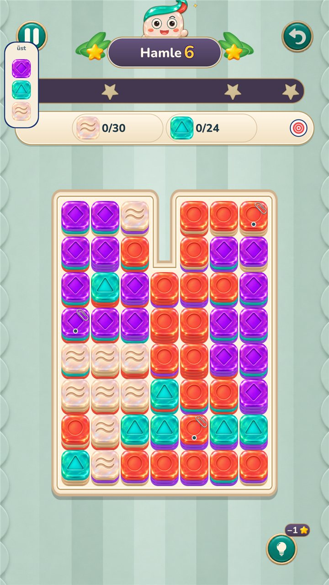 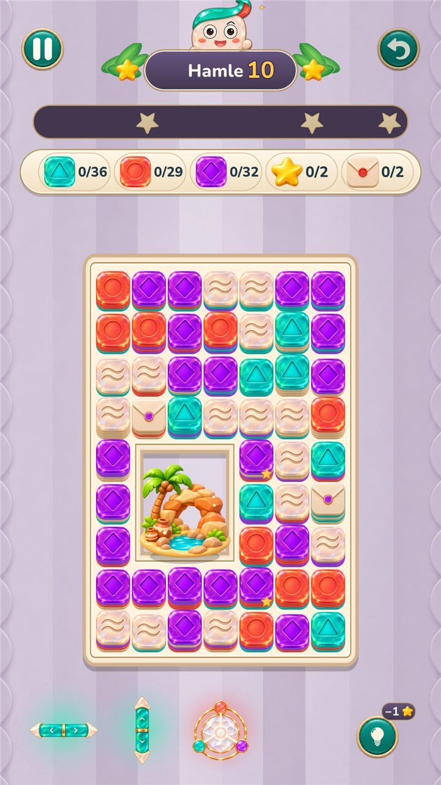 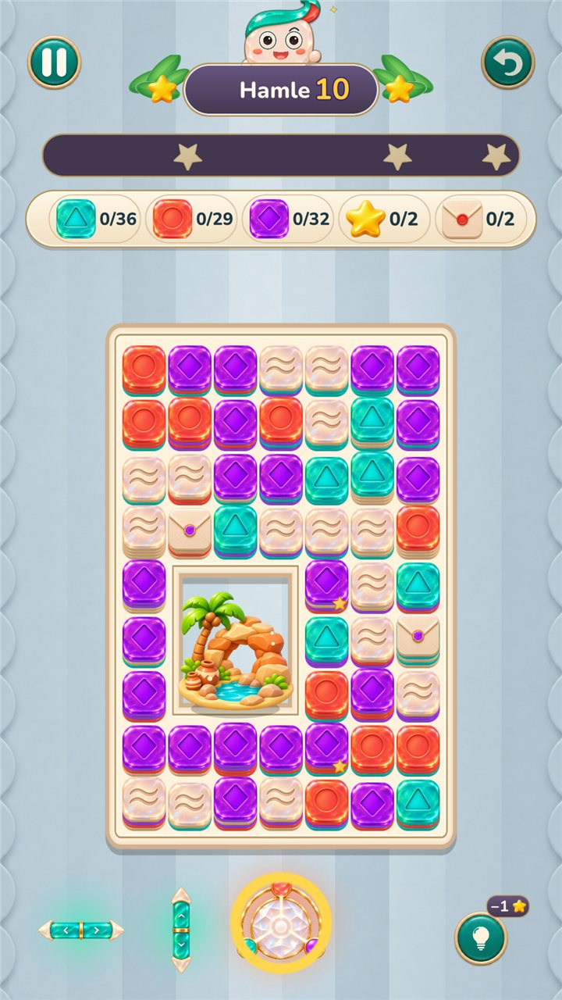

**Üst kısım (yukarıdan aşağı)**

| Öğe | Anlamı |
|---|---|
| Duraklat (sol üst) | Duraklat kartını açar. |
| Maskot | Hamle kapsülünün üstünde. Gözleri etrafa bakar, zincirde ve özel taşta zıplar, son 1–3 hamlede endişelenir. |
| **Hamle kapsülü** | Kalan hamle (koyu mor, sayı sarı). İki yanında yaprak ve yıldız süsü vardır. |
| Geri al (sağ üst) | Son tam hamleyi (zincirleriyle birlikte) geri alır. |
| **Yıldız çubuğu** | Puan ilerledikçe dolar. Üç yıldız işareti 1., 2. ve 3. yıldız eşiklerini gösterir. |
| **Hedef kartı** | Hedef çipleri: renk (sayı/hedef), dip yıldızı, zarf, sünger vb. Sağda varsa bölüm türünün kural simgeleri. |

**Tahta**
- Ortada şekilli tahta durur (dikdörtgen, L, artı, U, çatı…). Bazı bölümlerde ortası boştur ve boşluğa hareketli süs konur (vaha, fener, maskot).
- Her hücre bir **taş yığınıdır**. Yalnız en üst katman görünür ve seçilebilir. Yığının yanındaki ince şeritler alttaki katmanların renklerini ipucu olarak gösterir.
- Taşlar renk ve şekille okunur: mercan **daire**, turkuaz **üçgen**, inci **çift dalga**, mor **elmas**.
- Engeller taşın üstünde simgeyle gösterilir: ataş (kâğıt ataşı), zarf (mühürlü mektup), dip yıldızı (küçük yıldız), kristal (elmas rozet), buz vb.

**Alt kısım**
- **Özel taş tepsisi** (sol alt, en çok 4 yuva): satır roketi, sütun roketi, Altın Rulo. Tepsideki taşın çevresinde altın hale ve ışıltı vardır. Seçili taş büyür ve dönen altın halkayla belirginleşir (sağdaki görsel).
- **İpucu (ampul)** (sağ alt): üstünde "−1 ★" rozeti vardır. Reklam izlenince sıradaki hamle gösterilir.

**Katman görünümü** (soldaki görsel): bir yığına basılı tutunca (0,42 sn) sol üstte o yığının bütün katmanları yukarıdan aşağıya gösterilir ("üst"). Parmak kalkınca kaybolur.

---

## 11. Oyun içi kartlar ve yardımlar

### 11.1 Öğretici tur

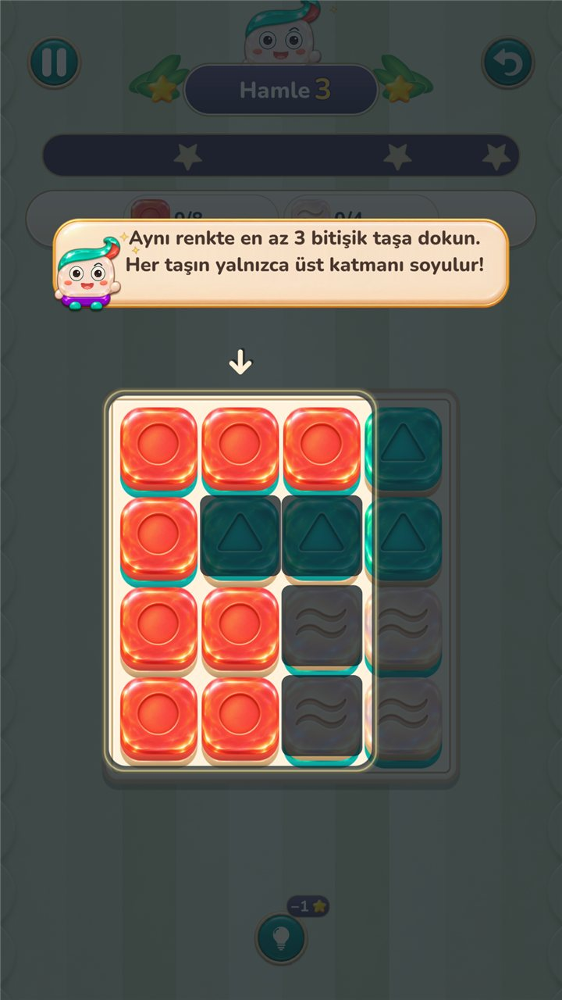

- Yönlendirmeli turlar 1, 2, 6 ve 9. bölümlerdedir. 12. bölümde bir bilgi adımı, her yeni mekaniğin ilk bölümünde de kısa bir tanıtım çıkar.
- Odak alanı açık kalır, çevresi kararır. Maskotlu konuşma balonu (örnekte "Aynı renkte en az 3 bitişik taşa dokun. Her taşın yalnızca üst katmanı soyulur!") ve zıplayan ok gösterilir.
- Yalnız gösterilen gruba dokunulabilir.

### 11.2 Kural kartları

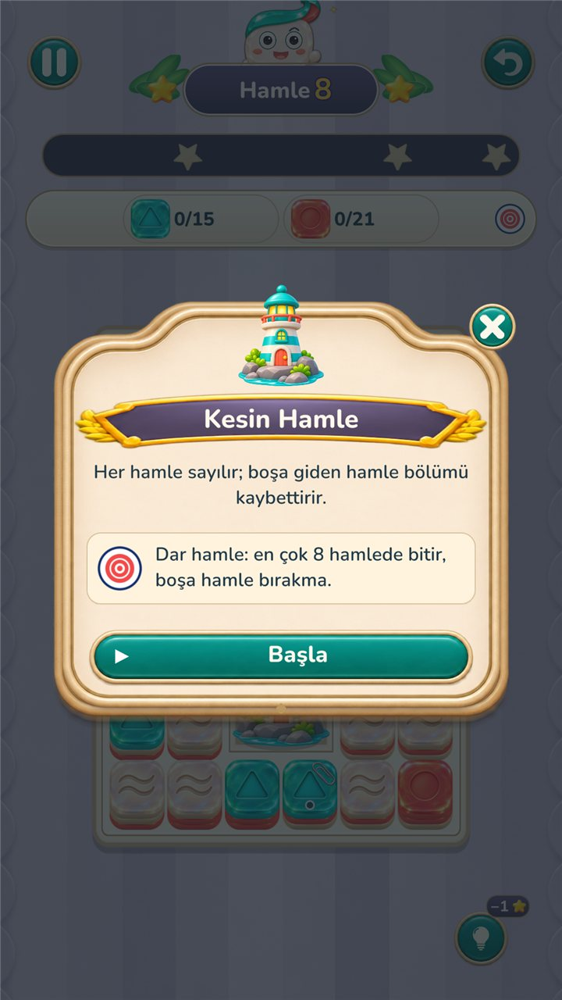 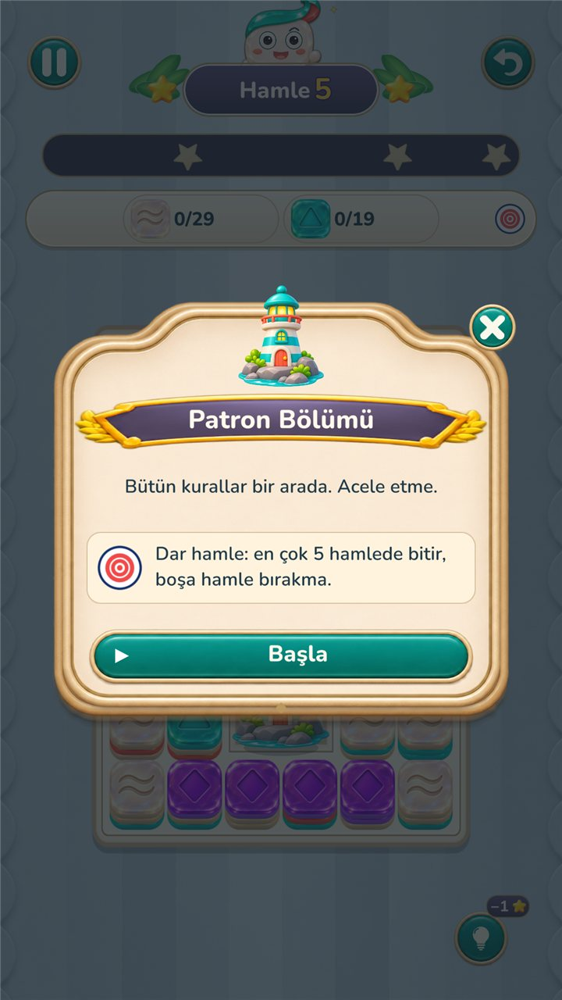 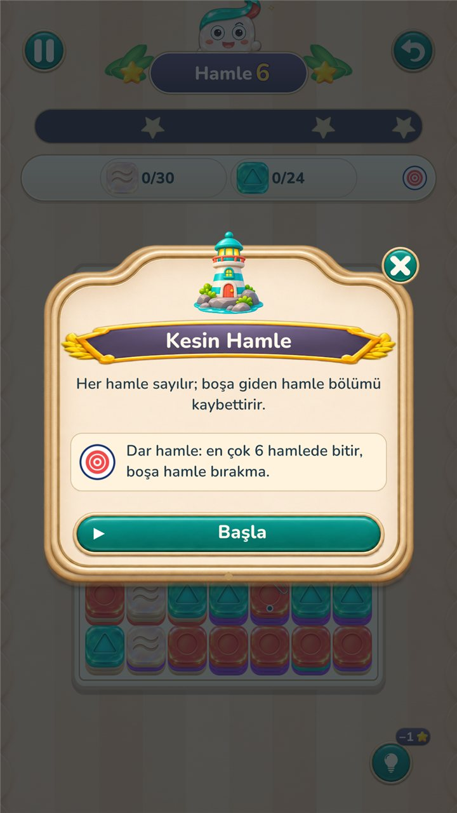

- Bir bölüm türü ilk kez görüldüğünde, her patron bölümünde ve her günlük bulmacada açılır.
- **Kartın yapısı:** bölge simgesi (örnekte fener), tür adı şeridi, tek cümle açıklama ("Her hamle sayılır; boşa giden hamle bölümü kaybettirir."), kural satırları (simge + cümle, örnekte "Dar hamle: en çok 8 hamlede bitir, boşa hamle bırakma.") ve **Başla** düğmesi.
- Patron kartında başlık "Patron Bölümü" olur, açıklama "Bütün kurallar bir arada. Acele etme." olur.
- `12_oyun_ekrani.jpg` 38. bölümün açılışıdır, kural kartı tahtanın üstünde görünür.

### 11.3 Boya paleti

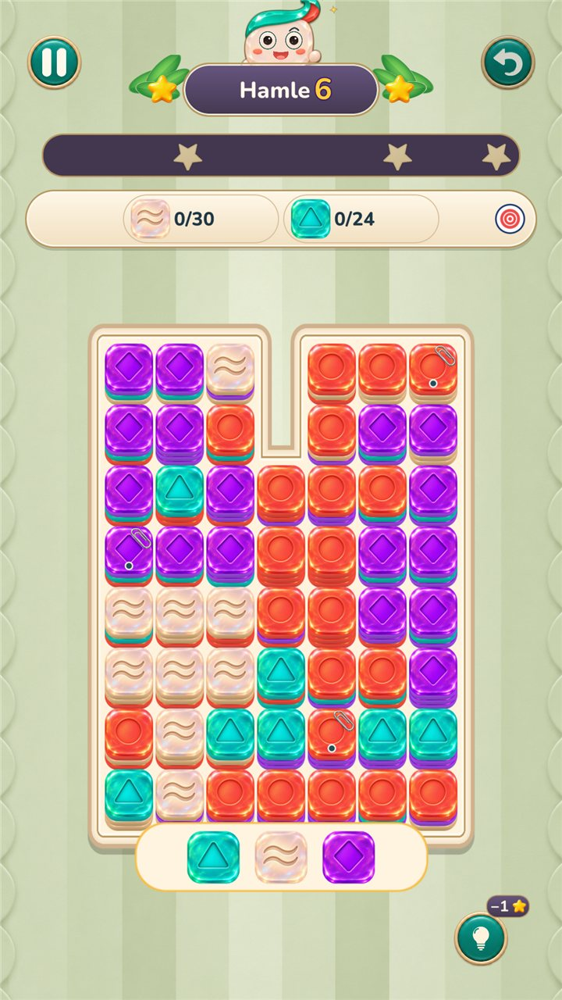

- **Boya damlası** mekaniğinde (701+) bir yığın seçilince tahtanın altında renk seçenekleri çıkar.
- Seçilen renk yığının üst katmanının yerine geçer.

### 11.4 Özel taş kullanımı

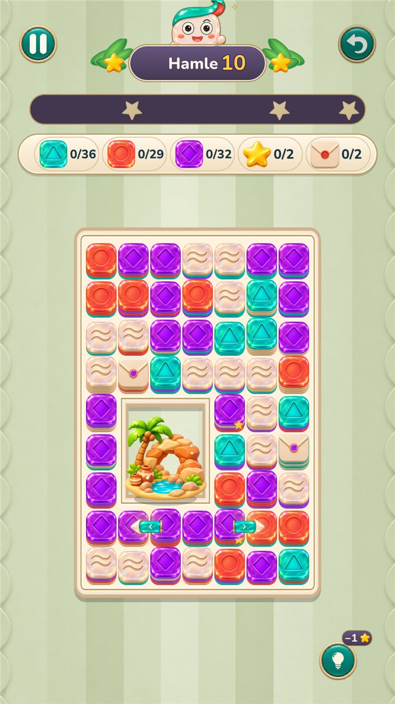 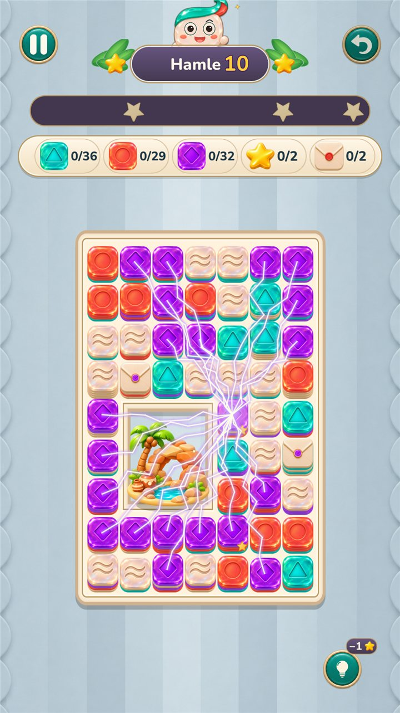

- **Roket:** tepsiden seçilip tahtada bir taşa dokunulunca roket o satırda (ya da sütunda) yerinde büyüyüp parlar, sonra ikiye bölünüp iki yöne uçar ve geçtiği taşları soyar (soldaki görsel).
- **Altın Rulo:** dokunulan taşın rengindeki bütün açık taşlara kaynaktan yıldırım atar ve hepsini soyar (sağdaki görsel).

### 11.5 İpuçları

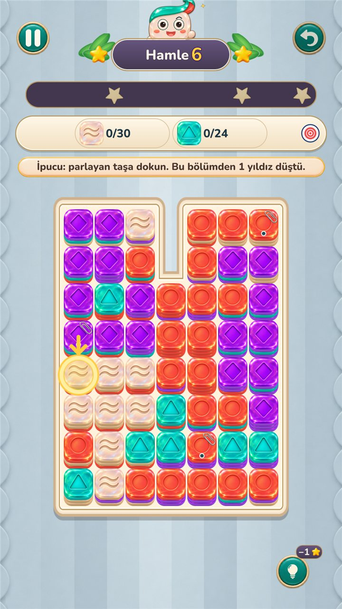 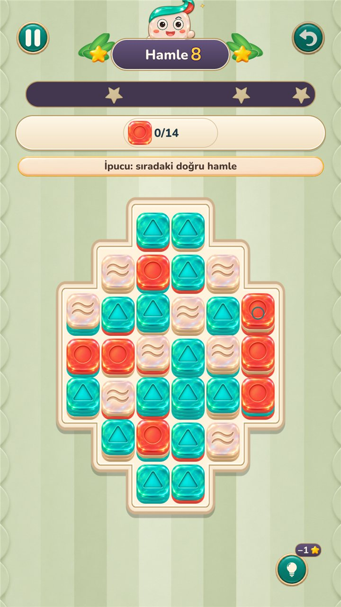

| Tür | Nasıl açılır | Görünüm |
|---|---|---|
| **Reklamlı ipucu** (soldaki) | Ampul düğmesi → ödüllü reklam | Doğru taş altın halka ve okla parlar. Şerit: "İpucu: parlayan taşa dokun. Bu bölümden 1 yıldız düştü." |
| **Kayıp sonrası ipucu** (sağdaki) | Aynı bölümde 2 kayıptan sonra kayıp kartındaki **İpucu** | Bölüm baştan başlar, yalnız ilk doğru hamle ince bir halkayla işaretlenir. Şerit: "İpucu: sıradaki doğru hamle". |

### 11.6 Duraklat

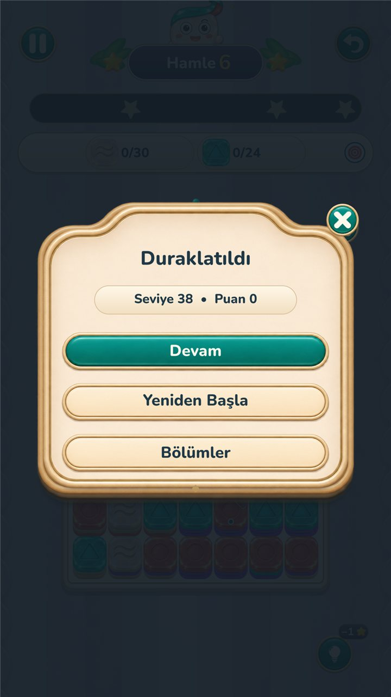

- Sol üstteki duraklat düğmesiyle açılır.
- Üzerinde "Duraklatıldı", seviye ve puan yazar. Düğmeler: **Devam**, **Yeniden Başla**, **Bölümler**.
- 21. bölümden itibaren ilk hamleden sonra Yeniden Başla ya da Bölümler seçilirse 1 kalp gider.

---

## 12. Sonuç kartları

### 12.1 Zafer kartı

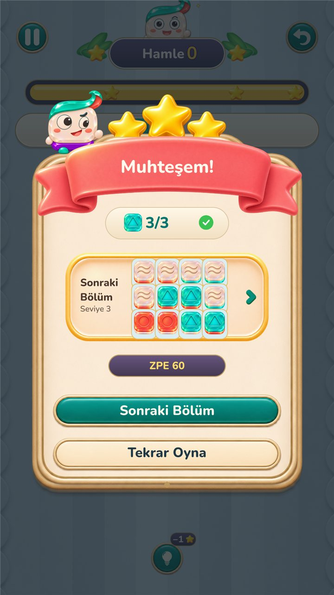

- Bütün hedefler dolunca, bitiş kutlamasından sonra açılır. Kutlamada kalan hamleler roket olarak ateşlenir, tepsideki özel taşlar patlar.
- **Üst kısım:** 1–3 yıldız ve kırmızı kurdele başlık (yıldıza göre "Muhteşem!" vb.).
- **İçerik:** hedef özeti (✓) ve **Sonraki Bölüm** önizlemesi (tahtanın küçük resmi ve seviye). Bu bölümün ZPE puanı (örnekte "ZPE 60") da gösterilir.
- **Düğmeler:** **Sonraki Bölüm**, **Tekrar Oyna**.
- Geçiş reklamı yalnız buradaki ilerleme düğmesinde, sıklık kuralına göre çıkar.

### 12.2 Kayıp kartı (hamle bitti)

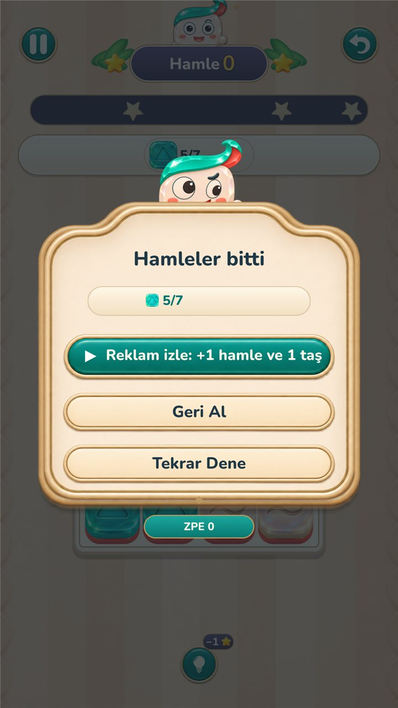 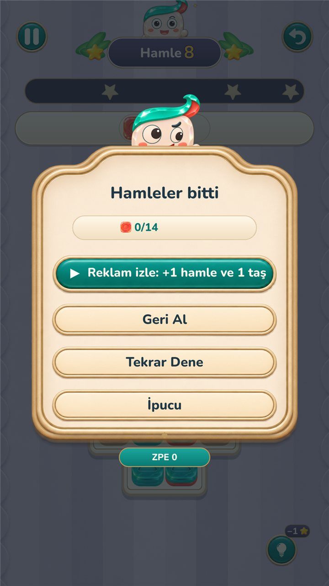 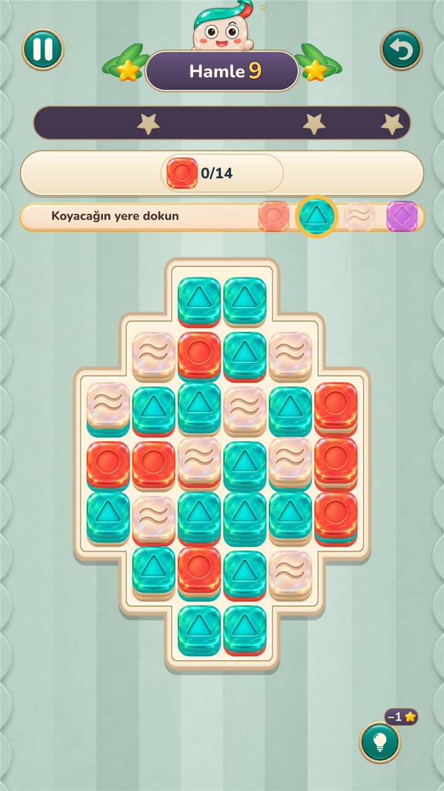

- Hamle bitip tepside işe yarayan özel taş kalmayınca açılır. Maskot kartın üstünden endişeyle bakar.
- **İçerik:** "Hamleler bitti" başlığı ve hedef durumu (örnekte 5/7).
- **Düğmeler:**
  - **Reklam izle: +1 hamle ve 1 taş:** bölüm başına bir kez.
  - **Geri Al:** son hamleyi geri alıp sürdürür.
  - **Tekrar Dene.**
  - **İpucu:** aynı bölümde 2 kayıptan sonra eklenir (ortadaki görsel).
- Kartın altında bu denemenin ZPE değeri gösterilir.

**Taş yerleştirme** (sağdaki görsel): reklam izlenince +1 hamle eklenir ve hedef kartının altında 4 taş seçeneği çıkar (önce hedef renkleri). Şeritte "Koyacağın yere dokun" yazar. Bir taş seçilip bir yığının üstüne konur, diğer seçenekler kaybolur. Konan taş yeni üst katman olur.

### 12.3 Kristal kırıldı

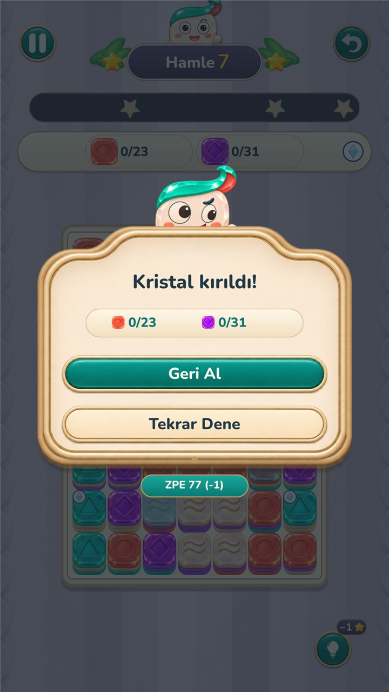

- **Kristal Koruma** kuralı olan bölümlerde kristal yığından katman soyulursa (zincir ya da roketle de olsa) bölüm hemen kaybedilir.
- Kartta "Kristal kırıldı!" başlığı ve hedef durumu yazar. Düğmeler: **Geri Al**, **Tekrar Dene**. Reklamlı devam yoktur.
- Altta ZPE ve değişimi gösterilir (örnekte "ZPE 77 (−1)").

---

## 13. Ayarlar

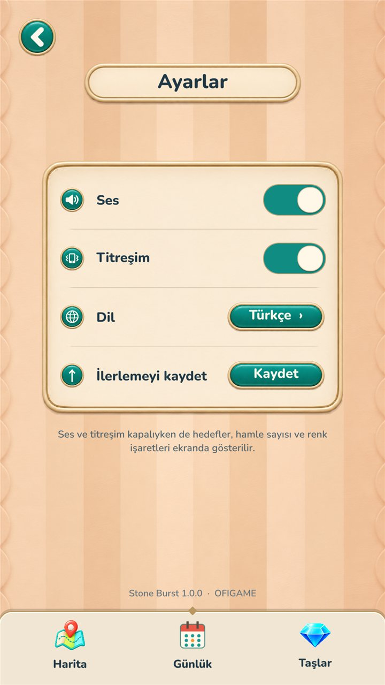 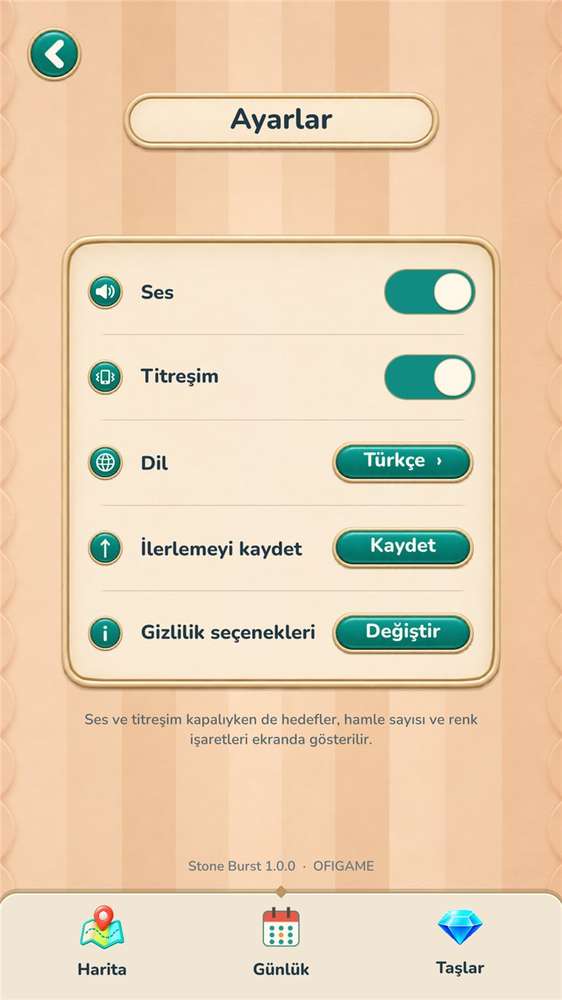 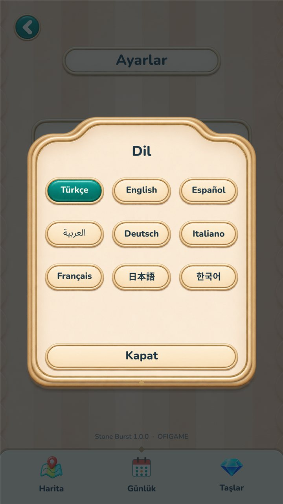

| Satır | Eylem |
|---|---|
| **Ses** | Aç / kapat anahtarı. |
| **Titreşim** | Aç / kapat anahtarı. |
| **Dil** | Seçili dil düğmesi. **Dil** kartını açar: 9 dil (Türkçe, English, Español, العربية, Deutsch, Italiano, Français, 日本語, 한국어), her biri kendi yazısıyla. Dil değişince ekranlar yeniden kurulur. |
| **İlerlemeyi kaydet** | **Kaydet:** hesapla giriş yapar (gerekirse) ve ilerlemeyi buluta yazar. |
| **Gizlilik seçenekleri** | **Değiştir:** reklam izin (UMP) formunu yeniden açar. Yalnız izin gereken bölgelerde (AB vb.) görünür (ortadaki görsel). |

- Kartın altında not vardır: "Ses ve titreşim kapalıyken de hedefler, hamle sayısı ve renk işaretleri ekranda gösterilir."
- En altta sürüm yazar: "Stone Burst 1.0.0 · OFIGAME".

---

## 14. Reklam ekranları

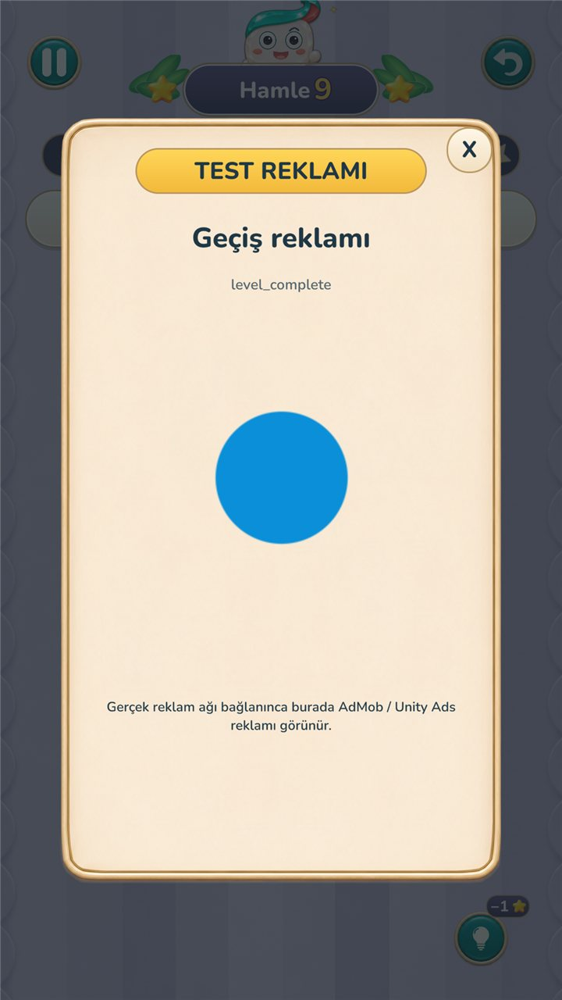

- `18`, `19` ve `20` numaralı görseller **test reklam ekranıdır**. Editörde ve reklam ağı bağlı olmayan derlemelerde görünür ("TEST REKLAMI" etiketi, reklam yerinin kodu: `daily_entry`, `level_complete`).
- Cihaz derlemesinde (iOS ve Android) bunların yerine AdMob reklamları açılır. Android kapalı testte Google'ın **test** reklamları kullanılıyor.
- **"Reklam aranıyor…"** kartı: reklam en çok 5 saniye aranır. Bulunamazsa sonuç reklam yerine göre değişir: günlük bulmacaya reklamsız girilir; kayıp kartındaki +1 hamlede ise "reklam bulunamadı" uyarısı çıkar ve ödül verilmez.

---

## 15. Gözlenen sorunlar ve düzeltmeler (2026-11-11)

Yakalamalar incelenirken bulunanlar. Düzeltmeler bir sonraki mağaza derlemesine girer; şu an incelemedeki iOS ve Android 1.0.0 derlemelerinde **yoktur**.

| # | Sorun | Durum |
|---|---|---|
| 1 | Günlük Bulmaca kartının altında "Prototip: reklam ve gün bilgisi sahte/yerel." notu koşulsuz görünüyordu. | **Düzeltildi:** not kaldırıldı (`MenuView.Ui1.cs`, `MenuView.Meta.cs`). |
| 2 | Giriş düğmesi "Reklam izle ve gir (deneme)" yazıyordu (bütün dillerde "(test)" eki). | **Düzeltildi:** ek 9 dilde kaldırıldı (`daily.enter.ad`). |
| 3 | ZPE panelinde "Hesaba katılan bölüm · Başarı oranı · İlk denemede" satırı kartın kenarına taşıyordu. | **Düzeltildi:** satır genişliği 840 → 740, yazı sığana dek küçülür. |
| 4 | Bağlı ataş öğretici metni "hepsinin yanında soyma yapman gerekir" diyordu; motor "herhangi birinin yanında" kuralını uygular. | **Düzeltildi:** metin 9 dilde "herhangi birinin yanında soyma yapman yeter" anlamına çevrildi (`tut.mech.linkedClip`). |
| 5 | Koleksiyonda 10 "Gizli Hazine" taşı listeleniyordu ama hazine bulma bölümlere bağlı değil, kazanılamıyordu. | **Düzeltildi:** hazine bağlanana kadar bu bölüm koleksiyonda gösterilmez (`GameController.Meta.cs`, `TreasuresAvailable`). |
| 6 | Deneme Bölümleri listesine haritadan giriş yok. | **Sorun değil:** onaylı karar (KARARLAR, 2026-11-08 v8): türler ana bölümlere taşındı, Deneme düğmesi haritadan kaldırıldı, liste kodda duruyor. |
