# Stone Burst: Oyun Mantığı, Metrikler ve Bölüm Aksiyonları

Sürüm 1.0.0 · 2026-11-11 · Unity 6000.6.4f1 · iOS ve Android

Bu belgedeki sayıların hepsi **koddan ve bölüm verisinden** (1000 bölüm JSON'u) çıkarıldı. Kaynak dosyalar her bölümün sonunda yazılı. Kısaltmalar: `S/` = `Assets/KatKat/Scripts/`, `R/` = `Assets/KatKat/Resources/`. Ekranların görsel anlatımı ayrı belgededir: [EKRANLAR.md](EKRANLAR.md).

---

## İçindekiler

1. [Oyun özeti](#1-oyun-özeti)
2. [Temel döngü](#2-temel-döngü)
3. [Bir hamlenin işleyişi](#3-bir-hamlenin-işleyişi)
4. [Özel taşlar ve tepsi](#4-özel-taşlar-ve-tepsi)
5. [Puan ve yıldız](#5-puan-ve-yıldız)
6. [Hedefler](#6-hedefler)
7. [Engeller ve mekanikler](#7-engeller-ve-mekanikler)
8. [Bölüm türleri](#8-bölüm-türleri)
9. [Bölüm verisi ve zorluk](#9-bölüm-verisi-ve-zorluk)
10. [Bölgeler](#10-bölgeler)
11. [Günlük bulmaca](#11-günlük-bulmaca)
12. [Koleksiyon taşları](#12-koleksiyon-taşları)
13. [Deneme bölümleri](#13-deneme-bölümleri)
14. [Kalpler](#14-kalpler)
15. [İpuçları ve yardımlar](#15-ipuçları-ve-yardımlar)
16. [Reklamlar](#16-reklamlar)
17. [ZPE (Zekâ Performans Endeksi)](#17-zpe-zekâ-performans-endeksi)
18. [Sıralama](#18-sıralama)
19. [Kayıt ve bulut](#19-kayıt-ve-bulut)
20. [Öğretici turlar](#20-öğretici-turlar)
21. [Analytics olayları](#21-analytics-olayları)
22. [Metrik özeti (tek tablo)](#22-metrik-özeti-tek-tablo)
23. [Belgelerle çelişkiler ve açık noktalar](#23-belgelerle-çelişkiler-ve-açık-noktalar)

---

## 1. Oyun özeti

- **Tür:** sıra tabanlı, sakin bir eşleştir-soy bulmacası. Zaman baskısı yoktur.
- **Fikir:** tahtadaki her hücrede üst üste dizilmiş renkli **taş katmanlarından** bir yığın durur. Yalnız en üst katman görünür ve seçilebilir. Oyuncu aynı renkte en az 3 bitişik üst katmana dokunur. O grubun her yığınından bir katman soyulur ve alttaki renkler ortaya çıkar.
- **Amaç:** sınırlı hamle içinde bölüm hedeflerini doldurmak (belirli sayıda renk, dip yıldızı, zarf, sünger…).
- **İçerik:**
  - 1000 bölüm, 10 bölgede.
  - Her gün değişen günlük bulmaca.
  - 22 koleksiyon taşı (şu an 12si görünür; 10 gizli hazine bağlanmadı).
  - 10 deneme bölümü.
  - Dünya ve ülke sıralaması.
- **Diller:** 9 dil (Türkçe kaynak; İngilizce, İspanyolca, Arapça, Almanca, İtalyanca, Fransızca, Japonca, Korece).

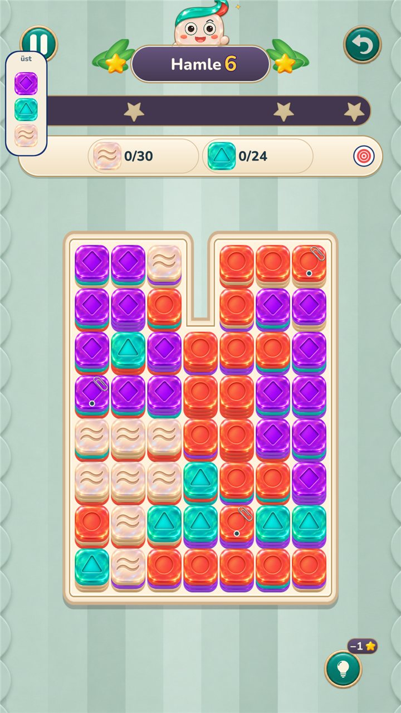

*Oyun ekranı. Sol üstte basılı tutulan yığının katmanları görünüyor (üstten alta mor, turkuaz, inci).*

---

## 2. Temel döngü

```text
Harita → bölüm seç → [kural kartı] → oyna (dokun → soy → zincir → hedef) ─┬─ hedefler doldu → kutlama → Zafer kartı → sonraki bölüm
                                                                         └─ hamle bitti → Kayıp kartı → reklamla devam / geri al / tekrar
```

**Oturum katmanı:**
- Her gün bir günlük bulmaca açılır. Reklamla girilir, yıldız ve ertesi bölümler için +1 hamle kazandırır.
- Toplanan yıldızlar koleksiyon taşlarını açar. Bazı taşlar günlük bulmacada güç verir.
- Performans ZPE puanına yazılır. ZPE, ulaşılan bölüm ve yıldız birlikte **sıralama puanını** oluşturur.
- 21. bölümden sonra yarıda bırakılan denemeler kalp harcar. Kalpler zamanla ya da reklamla dolar.

---

## 3. Bir hamlenin işleyişi

### 3.1 Taşlar

| Veri kimliği | Ekranda | Şekil |
|---|---|---|
| Coral | Mercan (kırmızı) | Daire |
| Blue | Turkuaz | Üçgen |
| Yellow | İnci (beyaz) | Çift dalga |
| Purple | Mor | Elmas |

- Her renk ayrıca şekille de ayırt edilir, renk körlüğünde de okunur.
- 1–20. bölümlerde 3 renk, sonrasında 3–4 renk kullanılır.

### 3.2 Seçilebilir hücre

Bir hücre dört koşulun hepsini sağlıyorsa seçilebilir:
- etkin,
- katmanı var,
- üstünde **örtü yok** (ataş, buz, renk kilidi, zarf, sünger, bağlı ataş),
- özel taş yok.

Kaynak: `S/Core/CellState.cs:54-55`.

### 3.3 Grup ve soyma

- **Grup:** aynı renkte **en az 3** hücre. Yalnız kenar komşuluğu sayılır, köşegen sayılmaz (`GroupFinder.MinGroup = 3`).
- **Soyma:** dokunulan grubun **her yığınından tam 1 katman** aynı anda kalkar.
- Her geçerli dokunuş **1 hamle** harcar. Döndürme, boya ve (eski) rulo da 1'er hamledir. Tepsi kullanımı ve zincirler hamle harcamaz.

### 3.4 Zincir (domino)

1. Soyma sonrası **altından yeni renk çıkan** hücreler aday olur.
2. Adaylar arasında yan yana **en az 3 aynı renk** varsa, onlar da hamle harcamadan kendiliğinden soyulur.
3. Bu dalga dalga sürer.
4. Yanlarında önceden açık olan aynı renk taşlar ne engeller ne de gruba katılır. Yalnız o dalgada ortaya çıkanlar sayılır.

- Güvenlik sınırı: toplam katman + hücre × 4 + 16 dalga.
- Kaynak: `S/Core/RulesEngine.cs:20, :394, :721-749`.

### 3.5 Hamlenin değerlendirilmesi

Her hamle ve zincir bitince şu sırayla bakılır (`RulesEngine.cs:228-236`):

| Sıra | Koşul | Sonuç |
|---|---|---|
| 1 | Kristal yığından katman soyuldu | **LostProtected** (kazanmadan önce bakılır) |
| 2 | Bütün hedefler doldu | **Won** |
| 3 | Hamle ≤ 0 ve tepside işe yarar taş yok | **LostOutOfMoves** |
| 4 | Hiç yasal hamle yok | **LostNoLegalMoves** |
| 5 | Hiçbiri | Oyun sürer |

**Yasal hamle sayılanlar:** işe yarar tepsi taşı, 3+ grup, döndürülebilir taban, tahtada özel taş, boya hakkı varken seçilebilir hücre, dolu rulo yuvası varken hedefli satır.

### 3.6 Geri al

- Son kabul edilen hamleyi **bütün zincirleriyle birlikte** geri alır. Tek adımlıktır.
- Kayıp kartından da kullanılabilir: oyuncu bir adım geri gidip sürdürür.
- Zafer kaydından sonra kapanır.
- Reklamla yapılan taş yerleştirme geri alma noktasını siler.
- Kullanılırsa oturum "yardımlı" sayılır (ZPE'de yardımsız bitirme bileşeni düşer).

---

## 4. Özel taşlar ve tepsi

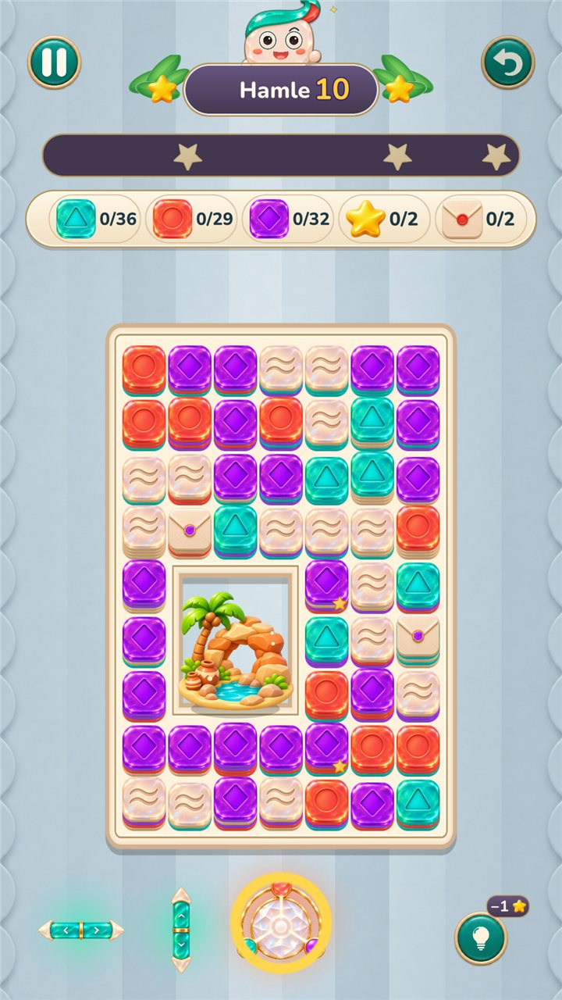 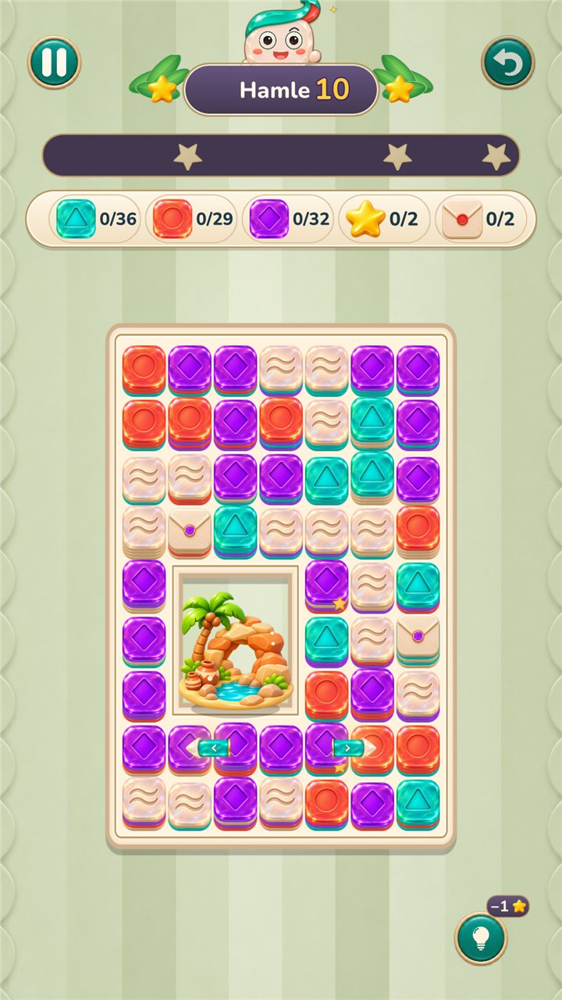 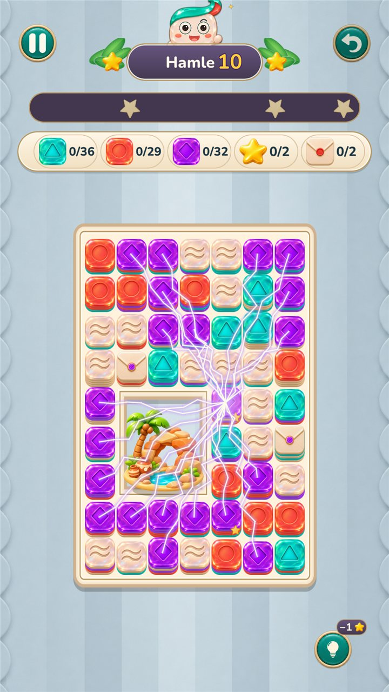

| Dokunulan grup | Doğan taş | Etki | Doğum puanı |
|---|---|---|---|
| 5–7 taş | **Roket.** Grup yatay genişse satır roketi, değilse sütun roketi | Satırın / sütunun bütün açık katmanlarını soyar, örtülere doğrudan vurur, yoldaki özel taşı tetikler | 50 |
| 8+ taş | **Altın Rulo** | Dokunulan taşın rengindeki bütün seçilebilir üst katmanları soyar | 100 |

- Özel taş yalnız **doğrudan dokunulan** gruptan doğar, zincirden doğmaz.
- Doğan taş tahtada durmaz, **tepsiye** uçar. Tepsi en çok **4** yuvalıdır. Tepsi doluysa yalnız puan verilir.
- **Kullanım:** tepsideki taşa, sonra tahtada bir taşa dokunulur. Tepsi kullanımı **hamle harcamaz**. Hedefte etkisi olmayacaksa reddedilir.
- Hamle bitse bile tepside işe yarar taş varsa oyun sürer.
- Özel taş doğmayan bölümler: 1–5, Tek Dokunuş ve Saf Plan bölümleri, bazı patronlar (toplam 50 bölüm).

**Bitiş kutlaması** (yalnız kazanınca) sırasıyla:
1. Tahtadaki özel taşlar ateşlenir.
2. Tepside kalan her taş rastgele bir hücrede ateşlenir.
3. **Kalan her hamle** bir rokete dönüşüp ateşlenir.

Kutlama puanı yıldıza sayılır. Ekrana dokununca kutlama atlanır. Rastgelelik bölüm kimliğinden üretilen sabit bir tohumla yapılır, yani hep aynı sonucu verir.

Kaynak: `RulesEngine.cs:26-29, :245-313, :416-417, :691-717`; `S/Core/LevelState.cs:27`.

---

## 5. Puan ve yıldız

### 5.1 Puan tablosu (`S/Core/Scoring.cs`)

| Olay | Puan |
|---|---|
| Soyulan her katman (dalga sırası *i*, 0'dan başlar; zincir ve özel taş dalgaları dahil) | **10 × (1 + *i*)** |
| Örtü vuruşu (ataş, buz, renk kilidi, sünger yuvası, bağlı ataş grubu; dalga başına) | 20 |
| Zarf açılması, sünger tamamlanması, düğmeye basılması | 50 |
| Dip yıldızı | 50 |
| Roket doğumu | 50 |
| Altın Rulo doğumu | 100 |

Domino uzadıkça her katman daha değerli olur. Örneğin üçüncü zincir dalgasındaki bir katman 40 puandır.

### 5.2 Yıldız

| Yıldız | Koşul |
|---|---|
| 1 | Bölümü kazanmak |
| 2 | Puan ≥ `stars[0]` |
| 3 | Puan ≥ `stars[1]` |

- Eşikler her bölümün verisinde yazılıdır. `stars[1]`, kayıtlı çözüm ve kutlama puanından türetilir. `stars[0]` ise onun **%75**'idir (1000 bölümde oran 0,747–0,752).
- Bölüm başına yalnız **en iyi** sonuç sayılır. Tekrar oynamak yıldız biriktirmez.
- Reklamlı ipucu kullanılırsa kazanılan yıldız **1 azalır** (en az 1 kalır).

---

## 6. Hedefler

| Hedef | Veri adı | İlk bölüm | Nasıl dolar |
|---|---|---|---|
| Renk toplama | `collectColor` | 1 | O renkten soyulan her katman (dokunuş, zincir, özel taş) |
| Dip yıldızı | `collectStars` | 41 | Yıldızlı yığın son katmanıyla boşalınca |
| Zincir rengi | `collectChain` | 47 | Yalnız **zincir dalgasında** soyulan o renk katmanlar |
| Zarf | `collectToken: envelope` | 201 | Zarf açılınca |
| Sünger | `collectToken: sponge` | 401 | Süngerin bütün yuvaları dolunca |

Kaynak: `S/Core/GoalType.cs`, `S/Levels/LevelLoader.cs:68-84`, `RulesEngine.cs:808-816`.

---

## 7. Engeller ve mekanikler

Bölüm sayıları 1000 bölümün taranmasıyla bulundu. Bir hücrede en çok bir örtü bulunur.

| Mekanik | İlk bölüm | Bölüm sayısı | Değerler | Kural |
|---|---|---|---|---|
| **Ataş** | 21 | 62 | 1 vuruş (121 hücre), 2 vuruş (45) | Yığın seçilemez. Kenar komşusunda soyma olan ya da doğrudan vurulan her dalgada 1 hasar alır. |
| **Dip yıldızı** | 41 | 92 | — | Yığın tamamen boşalınca toplanır, 50 puan. |
| **Buz** | 61 | 172 | 1 vuruş (644), 2 vuruş (222) | Ataşla aynı kural, renk önemsiz. |
| **Renk kilidi** | 121 | 197 | Sayaç 3–10, en sık 8 | Tahtanın **herhangi bir yerinde** kilit renginde kalkan her katman sayacı 1 düşürür. Doğrudan vuruş da 1 düşürür. 0'da açılır. |
| **Zarf** | 201 | 183 | — | Kenar komşusundan **mühür renginde** katman kalkınca ya da doğrudan vuruşla açılır. Zarf hedefine sayılır, 50 puan. |
| **Döner taban** | 301 | 167 | — | Dokununca 1 hamle harcar. Yığının sırası döner: en üstteki katman en alta iner, alttakiler birer basamak yükselir. Yığında en az 2 katman olmalı. Puan ve zincir yok. |
| **Sünger** | 401 | 205 | 2 renk (195), 3 renk (78) | Komşusundan kalkan her **gerekli renk** bir yuva doldurur. Dolan yuva kalıcıdır. Hepsi dolunca sünger toplanır, 50 puan. |
| **Bağlı ataş** | 501 | 147 | 1 vuruş (118), 2 vuruş (263) | Aynı gruptaki ataşlardan **herhangi birinin** yanında soyma olunca bütün grup birlikte 1 hasar alır. |
| **Düğme / geçit** | 601 | 147 | — | Dibinde düğme olan yığın boşalınca kapalı geçit hücreleri katmanlarıyla açılır. Açılan hücre o dalgada zincir başlatamaz. 50 puan. |
| **Boya damlası** | 701 | 147 | Bölüm başına 1 boya | 1 hamle harcar. Seçilen yığının yalnız üst rengini değiştirir. Aynı renge boyamak reddedilir. |
| **Kristal** | 60 (patron) | 39 | — | Bu yığından bir katman bile soyulursa (zincir ve roket dahil) bölüm **hemen kaybedilir**. |

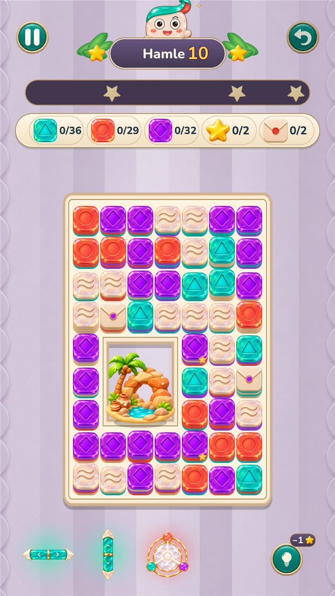 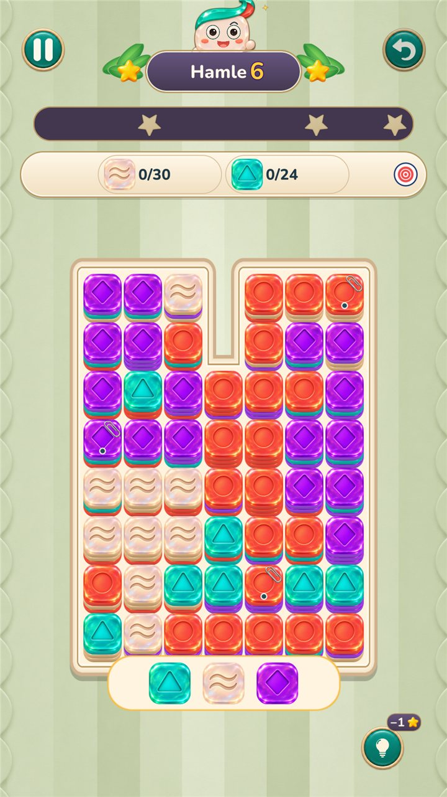 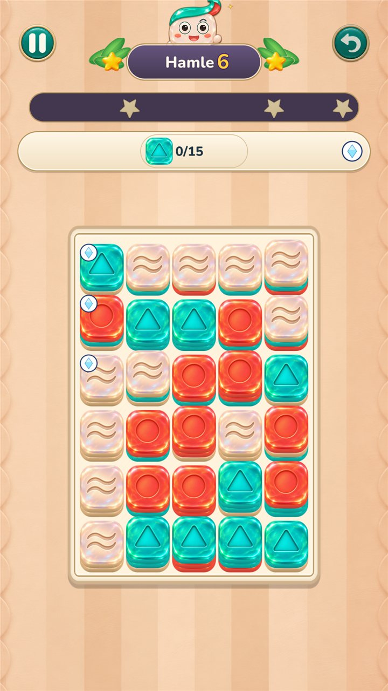

*Soldan: zarf ve dip yıldızlı, ortası boş (vaha süslü) tahta; boya paleti ve ataşlar; kristal yığınlar (elmas rozet).*

**Tahta şekilleri:**
- Dikdörtgen değil, karelerden oluşan dış hatlar: kesik köşe, L, T, artı, merdiven, kum saati, U, çatı, elmas.
- Bazı bölümler **ortası boştur**: halka, çift göz, kesik halka. Boşluğa yalnız görsel olan hareketli bir süs konur (maskot, fener, çeşme, vaha).

Kaynak: `RulesEngine.cs:62-87, :550-673`.

---

## 8. Bölüm türleri

Bazı bölümler bir **tür** taşır. Tür bir kural verir ama strateji vermez. Kural, tür ilk görüldüğünde ve her patron bölümüne girişte kural kartıyla anlatılır. Sonra kural simgesi hedef kartının sağında kalır.

| Tür | Kural (oyuncuya) | Motor karşılığı | Bölüm sayısı | İlk |
|---|---|---|---|---|
| **Kesin Hamle** | "Her hamle sayılır; boşa giden hamle bölümü kaybettirir." | Yalnız dar hamle limiti (motorda ayrı kural yok) | 38 | 27 |
| **Patron** | "Bütün kurallar bir arada. Acele etme." | Birkaç kural birlikte | 90 | 30 |
| **Ters Düşünme** | "Göz alıcı hamle her zaman doğru değildir." | Açgözlü hamlenin kaybettirdiği tahta (tasarım) | 24 | 37 |
| **Zincir Ustası** | "Hedef ancak zincirle dolar." | `collectChain` hedefi | 16 | 47 |
| **Tek Dokunuş** | "Tek hamlen var. Doğru taş bütün zinciri başlatır." | 5×6 tahta, 1 hamle | 20 | 49 |
| **Renk Kıtlığı** | "Bir renk az. Onu nerede harcadığına dikkat et." | Yalnız metin; tahtada hedef rengin neredeyse hepsi gerekir | 23 | 67 |
| **Kristal Koruma** | "Kristaller kırılmadan hedefe ulaş." | Kristal hücre (LostProtected) | 22 | 68 |
| **Saf Plan** | Özel taş doğmaz | `specials` kapalı | 17 | 77 |
| **Doğru An** | Özel taşsız çözülemez | Tasarım + dar hamle | 23 | 87 |
| **Kilit Sırası** | Renk kilitleri doğru sırayla açılmalı | Tasarım + dar hamle | 22 | 127 |
| Normal | — | — | 705 | — |

**Takvim (veriden):**
- Tür bölümleri genellikle numarası **7 ya da 8 ile biten** bölümlerdir.
- Tek Dokunuş, **9 ile biten** bölümlerdir (49, 99, 149…999).
- Patron, **0 ile biten** bölümlerdir. Patron olmayan 10'un katları: 10, 20, 120, 250, 420, 480, 850, 880, 930, 1000.
- 100'ün katı patronlar: 100–500 ve 900'de tek kural (Kesin Hamle); 600 ve 800'de üç kural (Kristal + Zincir + Kesin); 700'de üç kural (Saf Plan + Kıtlık + Kesin).

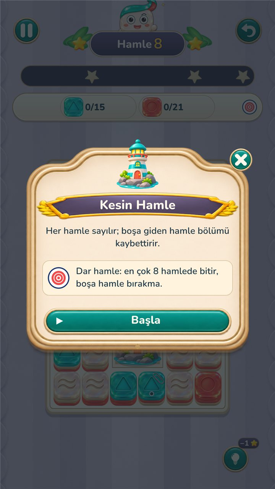 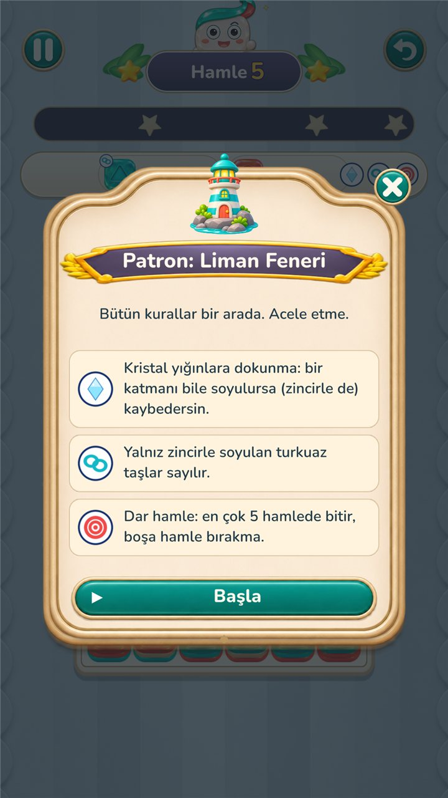

---

## 9. Bölüm verisi ve zorluk

### 9.1 Genel ölçüler (1000 bölüm)

| Ölçü | En az | En çok | Ortalama |
|---|---|---|---|
| Tahta genişliği | 4 | 8 | 7,0 |
| Tahta yüksekliği | 4 | 9 | 8,8 |
| Etkin hücre | 16 | 72 | 51,9 |
| Hamle limiti | 1 | 26 | 11,9 |
| Renk sayısı | 3 | 4 | 3,96 |
| En yüksek katman | 2 | 4 | 3,83 |

**Tahta boyutları:**

| Boyut | Bölüm |
|---|---|
| 7×9 | 774 |
| 8×9 | 91 |
| 7×8 | 85 |
| 6×7 | 25 |
| 5×6 (Tek Dokunuş) | 20 |
| 4×4 (bölüm 1–5) | 5 |

### 9.2 Aralıklara göre

| Bölümler | Hamle | Ort. hamle | Renk | Katman | Yeni gelen |
|---|---|---|---|---|---|
| 1–20 | 2–12 | 7,3 | 3 | 2–3 | Temel soyma, zincir, roket (6), Altın Rulo (9) |
| 21–100 | 1–19 | 9,5 | 3–4 | 3–4 | Ataş, dip yıldızı, buz, bölüm türleri, patron |
| 101–300 | 1–21 | 11,0 | 3–4 | 3–4 | Renk kilidi, zarf |
| 301–600 | 1–25 | 12,3 | 3–4 | 3–4 | Döner taban, sünger, bağlı ataş |
| 601–1000 | 1–26 | 12,8 | 3–4 | 3–4 | Düğme/geçit, boya, karışım |

### 9.3 Hamle payı (limit − kayıtlı çözümün adım sayısı)

| Bölümler | Pay aralığı | Ortalama |
|---|---|---|
| 1–5 | 0–2 | 1,0 |
| 6–20 | 4–6 | 5,0 |
| 21–60 | 3–7 | 4,5 |
| 61–300 | 2–9 | 4,8 |
| 301–1000 | 2–11 | 5,2 |

### 9.4 Zorluk yaklaşımı

- Zorluk hamle kıtlığından değil **plandan** gelir. Her bölümün kayıtlı bir çözümü vardır. Hamle limiti bu çözümün üstüne pay eklenerek konur.
- Renk hedefleri, basit (açgözlü) bir botun kazanma oranını hedef bir değere yaklaştıracak biçimde seçildi.
- Ölçülen bot kazanma oranları (`R/Zpe/level_ref.json`, ortalama 0,164):

| Bölümler | Bot kazanma oranı |
|---|---|
| 6–20 | ~%58 |
| 21–100 | ~%49 |
| 101–300 | ~%33 |
| 301–600 | ~%23 |
| 601–1000 | ~%17 |

- Her bölümün kayıtlı çözümünün kazandığı ve botun en az bazen kazandığı otomatik doğrulanır (`tools/LevelLab stress`).

---

## 10. Bölgeler

Her bölge 100 bölümdür. Harita teması üçlü döner: sahil → bahçe → çöl.

| Bölge | Bölümler | Ad | Tema |
|---|---|---|---|
| 1 | 1–100 | Mavi Liman | Sahil |
| 2 | 101–200 | Yeşil Vadi | Bahçe |
| 3 | 201–300 | Kum Vadisi | Çöl |
| 4 | 301–400 | Fener Koyu | Sahil |
| 5 | 401–500 | Çiçek Bahçesi | Bahçe |
| 6 | 501–600 | Vaha Yolu | Çöl |
| 7 | 601–700 | İnci Sahili | Sahil |
| 8 | 701–800 | Gül Vadisi | Bahçe |
| 9 | 801–900 | Altın Kumlar | Çöl |
| 10 | 901–1000 | Martı Limanı | Sahil |

İki "dünya" vardır: 1–500 ve 501–1000. Bunlar yalnız efsanevi taşların koşuludur, arayüzde gösterilmez.

---

## 11. Günlük bulmaca

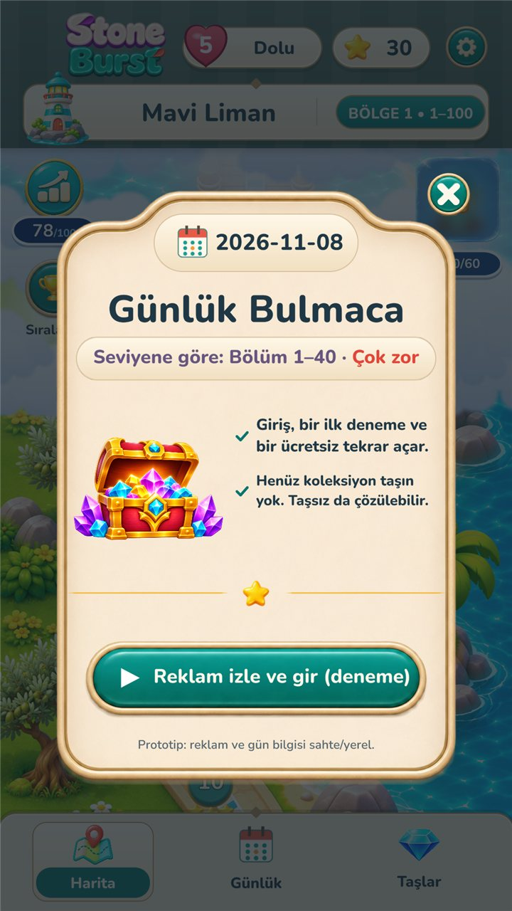 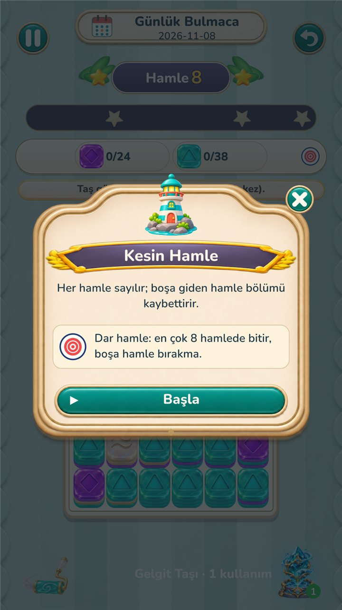 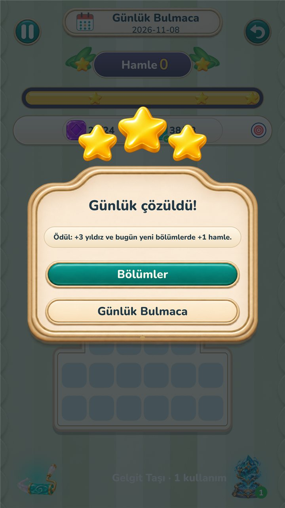

| Özellik | Değer |
|---|---|
| Giriş | Ödüllü reklam. Reklam bulunamazsa reklamsız girilir; reklam iptal edilirse hak açılmaz. |
| Deneme hakkı | Giriş başına 1 deneme + 1 ücretsiz tekrar = **2** |
| Katalog | 30 gün × 8 seviye grubu = 240 bulmaca (`daily-v3`). Gün = (2026-01-01'den beri geçen gün) mod 30. |
| Tür döngüsü (8 gün) | Kesin hamle → zincir → kristal → ters → kıt renk → saf plan → doğru an → kilit. Oyuncunun grubunda açılmamış tür yerine Kesin Hamle ya da Ters gelir. Her günlükte kural kartı gösterilir. |
| Yıldız | 1–3, bölümlerle aynı eşikler. **Günde bir kez** (günün ilk galibiyeti). Toplam yıldıza ve taş eşiklerine sayılır; ZPE'ye ve sıralamaya sayılmaz. |
| Ödül | Galibiyet günü, kazanılmamış normal bölümlerde **+1 hamle** |
| Koleksiyon taşı gücü | Deneme başına **1 kez** |

**Seviye grupları** (oyuncunun ulaştığı bölüme göre, günün ilk açılışında sabitlenir):

| Grup | 1 | 2 | 3 | 4 | 5 | 6 | 7 | 8 |
|---|---|---|---|---|---|---|---|---|
| Bölüm aralığı | 1–40 | 41–100 | 101–200 | 201–350 | 351–500 | 501–700 | 701–850 | 851–1000 |

Kaynak: `S/Levels/Meta/DailyService.cs`, `R/Daily/daily_index.json`.

---

## 12. Koleksiyon taşları

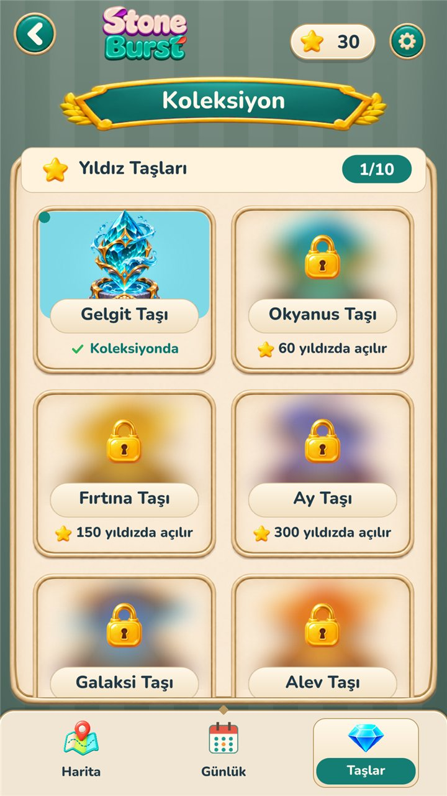 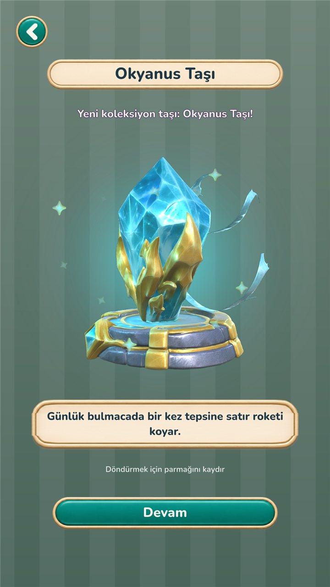

Toplam **22 taş**: 10 yıldız taşı, 10 gizli hazine, 2 efsanevi taş. Taş güçleri **yalnız günlük bulmacada** çalışır. Kazanılan ilk güçlü taş otomatik seçilir.

| Taş | Açılma koşulu | Günlük güç |
|---|---|---|
| Gelgit Taşı | 10. bölümü tamamla | Boş rulo yuvasını doldurur |
| Okyanus Taşı | 60 yıldız | Tepsiye satır roketi |
| Fırtına Taşı | 150 yıldız | Tepsiye sütun roketi |
| Ay Taşı | 300 yıldız | +2 hamle |
| Galaksi Taşı | 500 yıldız | Tepsiye Altın Rulo |
| Alev, Yaşam, Ayaz, Güneş, Kozmos | 750 / 1050 / 1400 / 1800 / 2250 yıldız | Yok |
| Gizli hazineler (10) | Hazine bulma | Yok. Hazine bulma bölümlere bağlı değil; bağlanana kadar koleksiyonda gösterilmez. |
| Anka Kristali | Bölüm 1–500 bitince | Yok |
| Buz Ejderhası Tacı | Bölüm 501–1000 bitince | Yok |

Toplam yıldız = bölüm yıldızları + günlük bulmaca yıldızları. Kaynak: `R/Collection/stones.json`, `S/Levels/Meta/Stones.cs`.

---

## 13. Deneme bölümleri

10 elle hazırlanmış bölümdür. Her bölüm türünden bir örnek ve bir patron vardır. Yalnız "tamamlandı" bilgisi kaydedilir; ilerlemeye, yıldıza, ZPE'ye ve sıralamaya yazılmaz.

| No | Tür | Kurallar | Tahta | Hamle |
|---|---|---|---|---|
| 1 | Tek Dokunuş | Kesin | 5×6 | 1 |
| 2 | Kesin Hamle | Kesin | 5×6 | 4 |
| 3 | Ters Düşünme | Kesin | 5×6 | 5 |
| 4 | Renk Kıtlığı | Kıtlık | 5×6 | 4 |
| 5 | Zincir Ustası | Yalnız zincir | 5×6 | 3 |
| 6 | Kristal Koruma | Kristal | 5×6 | 6 |
| 7 | Saf Plan | Özel taş yok + Kesin | 6×6 | 6 |
| 8 | Doğru An | Kesin | 6×6 | 3 |
| 9 | Kilit Sırası | Kesin | 5×6 | 4 |
| 10 | Patron | Kristal + Zincir + Kesin | 6×7 | 5 |

- 2 kayıptan sonra ücretsiz ipucu verilir: çözücü sıradaki hamleyi bulur.
- Deneme düğmesi haritadan bilerek kaldırıldı (onaylı karar, 2026-11-08: türler ana bölümlere taşındı). Liste ve bölümler kodda duruyor, şu an oyuncuya açık değil.

---

## 14. Kalpler

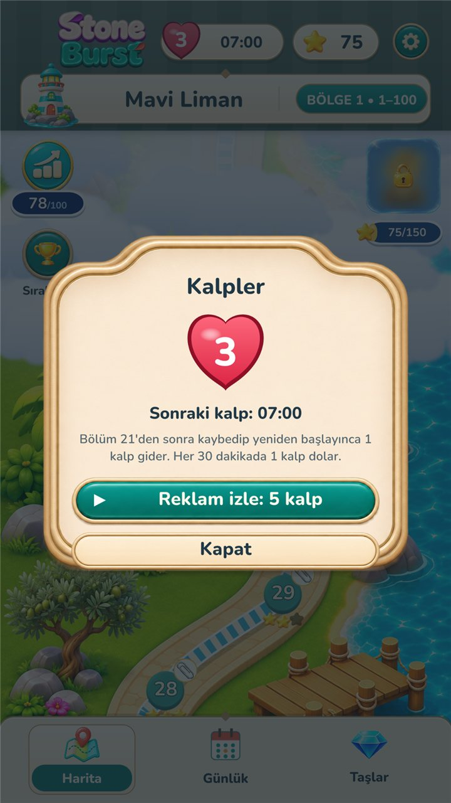

| Kural | Değer |
|---|---|
| En çok kalp | **5** |
| Dolum | Eksik kalp başına **30 dakika** (sayaç ilk eksilmede başlar) |
| Hangi bölümlerde | **21. bölümden** itibaren, yalnız normal bölümler (günlük ve deneme hariç) |
| Ne zaman düşer | İlk hamleden sonra deneme kazanılmadan bırakılırsa **1 kalp**: yeniden başlat, başka bölüm, harita, menü |
| Ne zaman düşmez | Kazanınca; kayıp kartından geri alıp sürdürünce; reklamla devam edince |
| Kalp yoksa | Bölüm açılmaz, "Kalplerin bitti" kartı çıkar |
| Reklam | Ödüllü reklam kalpleri **5'e** doldurur |

Kaynak: `S/Levels/Meta/Hearts.cs`, `S/Game/GameController.Hearts.cs`.

---

## 15. İpuçları ve yardımlar

| Yardım | Bedel | Sınır | Ne yapar |
|---|---|---|---|
| **Reklamlı ipucu** (ampul) | Ödüllü reklam + o bölümden kazanılan yıldız −1 (en az 1). Bedel yalnız öneri teslim edilince işlenir. | Yalnız normal bölüm, deneme başına 1 (yeniden başlatma yeni denemedir) | 2026-11-11'den beri doğrulanmış çözüm yolunun ilk komutunu gösterir (dokunuş, tepsi, döndürme, boya, rulo). Plan bulunamazsa reklam açılmaz, hak kullanılmaz. Ayrıntı aşağıda. |
| **Kayıp sonrası ipucu** | Ücretsiz | Aynı bölümde 2. kayıptan sonra | Bölüm baştan başlar; kayıtlı çözümün ilk adımı (her komut türü) doğrulanıp gösterilir |
| **Deneme ipucu** | Ücretsiz | Denemede 2 kayıptan sonra | Çözücü (300.000 durum) sıradaki hamleyi gösterir |
| **Öğretici halka** | — | Bölüm 1, 2, 11, 21, 41, 61, 121, 201, 301 | Kayıtlı çözümün ilk adımı |
| **Katman görünümü** | Ücretsiz | Her zaman | Yığına 0,42 sn basılı tutunca bütün katmanlar görünür |
| **Geri al** | Ücretsiz | Tek adım | Bkz. §3.6 |
| **+1 hamle ve taş** | Ödüllü reklam | Bölüm başına 1 | Bkz. §16 |

**Reklamlı ipucu akışı (2026-11-11, vr1 P0):**
1. Hazırlanıyor: tahta kopyasında arka planda çalışır. Önce kayıtlı çözüm denenir, sonra en-iyi-önce arama yapılır (40.000 durum + 750 ms).
2. Plan yoksa "güvenilir ipucu hazırlanamadı, hakkın kullanılmadı" yazar; reklam açılmaz.
3. Plan varsa reklam açılır.
4. Ödül gelince plan yeniden doğrulanır.
5. Teslim: bedel bu adımda işlenir.

Başka hamle ya da geri almadan sonra plan aynı hakla ücretsiz yeniden çözülür. Öneri uygulanınca hak biter. Kaynak: `S/Levels/HintPlanner.cs`, `S/Game/GameController.Hint.cs`.

Masaüstü ölçümü (oyun ortasında 100 durum): eski çözücü 56'sında dokunuş önerisi bulabiliyordu, yeni planlayıcı 99'unda doğrulanmış yol buldu. Ortalama 51 ms, en çok 752 ms. Cihaz süresi ölçülmedi.

**Yardımların etkisi:**
- Reklam yardımı alan oturum (reklamlı ipucu, +1 hamle) **ZPE'ye hiç yazılmaz**, kazandığı yıldız da **sıralama yıldızına sayılmaz**.
- Diğer yardımlar (geri al, ücretsiz ipucu, öğretici, günlük +1 hamle, taş gücü) ZPE'nin "yardımsız bitirme" bileşenini 1'den 0,3'e düşürür.

---

## 16. Reklamlar

Ağ: AdMob (iOS'ta gerçek kimlikler; Android kapalı testte Google test kimlikleri). Ayarlar `R/Ads/ad_config.json`, kurallar `S/Levels/Meta/Ads.cs`.

### 16.1 Ödüllü reklamlar

| Yer (kod) | Nerede | Ödül | Reklam bulunamazsa |
|---|---|---|---|
| `daily_entry` | Günlük bulmaca kartı | Günlük bulmacaya giriş (2 deneme) | Reklamsız giriş |
| `extra_moves` | Kayıp kartı (yalnız hamle bitince, normal bölüm, bölüm başına 1) | **+1 hamle ve 1 taş yerleştirme** | "Reklam bulunamadı" uyarısı, ödül yok |
| `extra_life` | Kalp kartı | Kalpler 5'e dolar | — |
| `hint` | Ampul düğmesi | 1 ipucu | — |

**Taş yerleştirme (`extra_moves` ödülü):**
- 4 renk sunulur: önce hedef renkleri, sonra tahtada en çok bulunanlar.
- Oyuncu birini seçip etkin, örtüsüz, kristal olmayan ve en yüksek katman sayısının altındaki bir yığının üstüne koyar.
- Konan taş yeni üst katman olur. Soyma tetiklemez, hamle harcamaz, geri alınamaz.

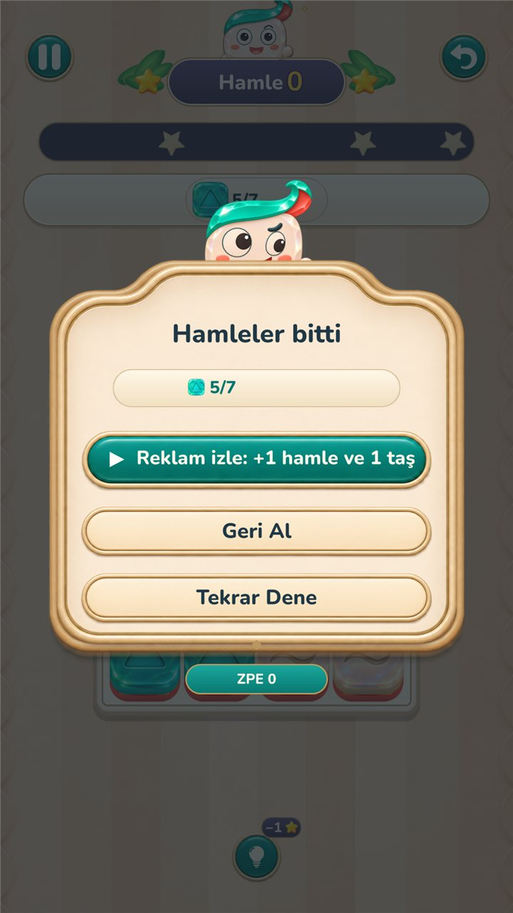 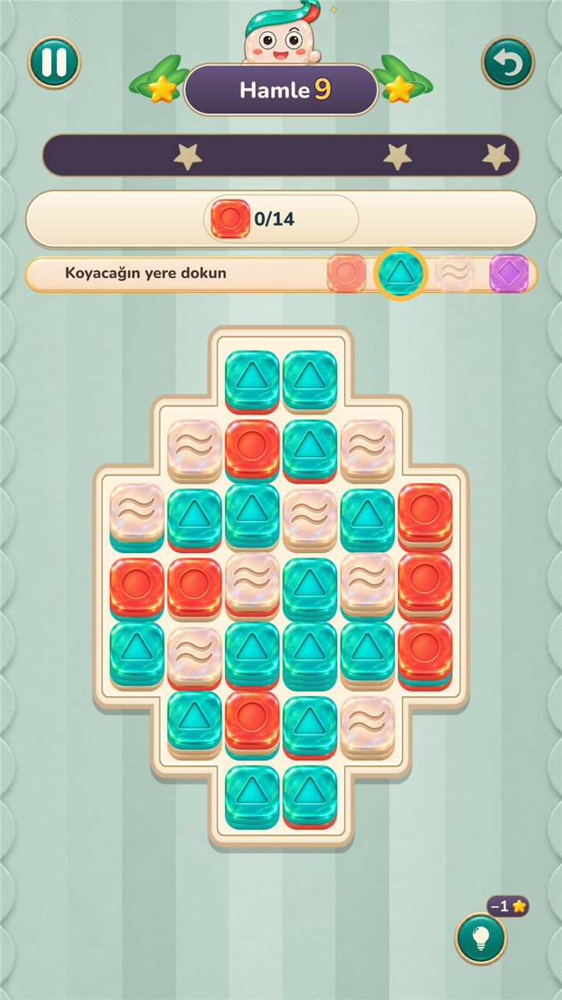

### 16.2 Geçiş reklamı (`level_complete`)

Yalnız normal bölümde, zafer kartında ilerlerken sorulur.

| Kural | Değer |
|---|---|
| İlk 10 bölüm | Hiç yok (bölüm ≥ 11) |
| Sıklık | Son gösterimden beri en az **4** bölüm kazanılmış olmalı |
| Gösterimler arası | En az **240 sn** |
| Ödüllü reklamdan sonra | **120 sn** geçiş reklamı yok |
| Oturum başına | En çok **8** |

### 16.3 Puan isteği (mağaza değerlendirmesi)

En az 15 tamamlanmış bölüm, yardımsız 3 yıldızlı bir galibiyetten sonra. İstekler arasında en az 120 gün olur, toplam en çok 3 istek yapılır. Geçiş reklamıyla aynı anda istenmez.

---

## 17. ZPE (Zekâ Performans Endeksi)

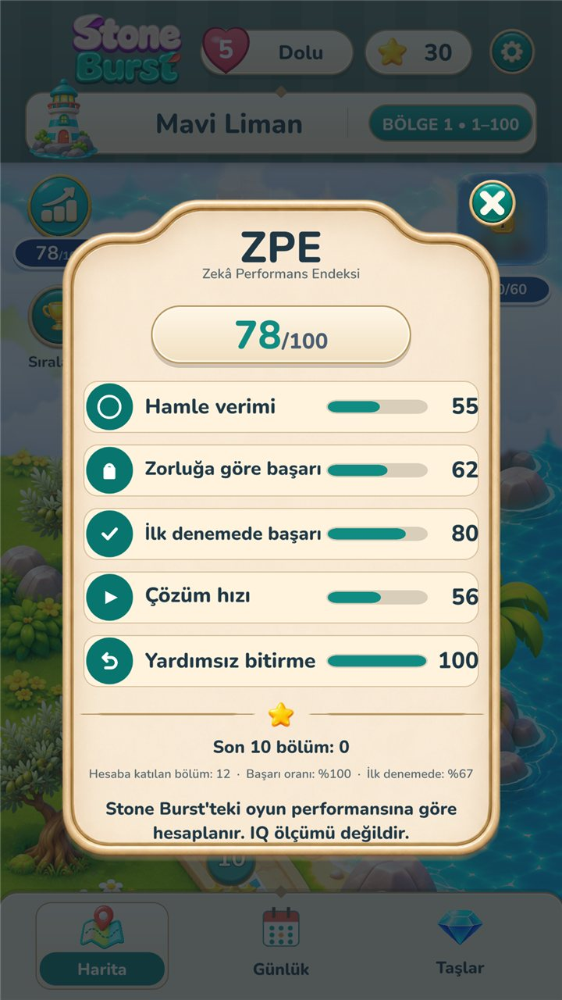

0–100 arası bir oyun performans puanıdır. **IQ değildir.** Yalnız normal bölümler sayılır; reklam yardımlı oturumlar hiç sayılmaz.

**Bölüm puanı:**
- Başarısız oturumun bütün bileşenleri 0'dır ve bu 0 ortalamaya girer.
- Başarılı oturumda puan şu beş bileşenin ağırlıklı toplamıdır:

| Bileşen | Ağırlık | Formül |
|---|---|---|
| Hamle verimi | %35 | Kayıtlı çözüm adımı kadar ya da daha az hamle = 1. Limite yaklaştıkça doğrusal düşer. |
| Zorluğa göre başarı | %25 | 0,35 + 0,65 × (1 − botun kazanma oranı) |
| İlk denemede başarı | %20 | İlk denemeyse 1, değilse 0,4 |
| Çözüm hızı | %10 | min(1, (6 + 4 × adım) / saniye). 2026-11-11'den beri saniye = yalnız **karar süresi** (aşağıda) |
| Yardımsız bitirme | %10 | Yardımsızsa 1, değilse 0,3 |

**Endeks:**
- Oynanan bütün oyunların düz ortalaması × 100.
- Panelde son 50 kaydın başarı oranı, ilk deneme oranı ve bileşen ortalamaları gösterilir.
- Eğilim (son 10 bölüm ile önceki 10 bölümün farkı) en az 20 kayıttan sonra hesaplanır.
- Bölüm sonunda "ZPE x (±d)" gösterilir.
- Kayıp kartından geri alınıp sürdürülen oturum çift sayılmaz: önceki kayıt geri çekilir.

**Süre ölçümü (2026-11-11, vr1 P0, `timeVer` 2):**
- Süre üç sayaca ayrılır.
- Karar süresi yalnız oyuncu girdi verebilirken artar: tahta durgunken ya da rulo satırı seçilirken. Hız bileşeni yalnız bu süreyi kullanır.
- Hamle, zincir ve özel taş animasyonu ile zorunlu öğretici turu ayrı sayılır; ZPE'ye girmez.
- Hiç sayılmayanlar: duraklatma ve diğer kartlar, menü, reklam ekranı, uygulamanın odak kaybı ya da arka planda olması, ipucu hazırlığı.
- Eski kayıtların süresi (animasyon dahil, `timeVer` 0) geriye dönük düzeltilemez; olduğu gibi kalır.
- Ağırlıklar ve endeks formülü değişmedi.

Kaynak: `S/Levels/Meta/Zpe.cs`, `R/Zpe/zpe_config.json`, `R/Zpe/level_ref.json`.

---

## 18. Sıralama

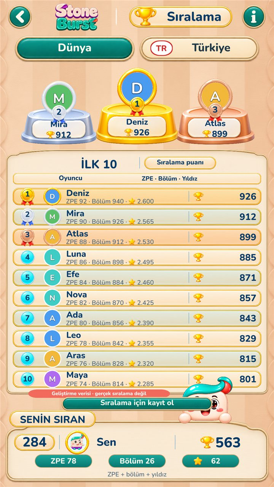 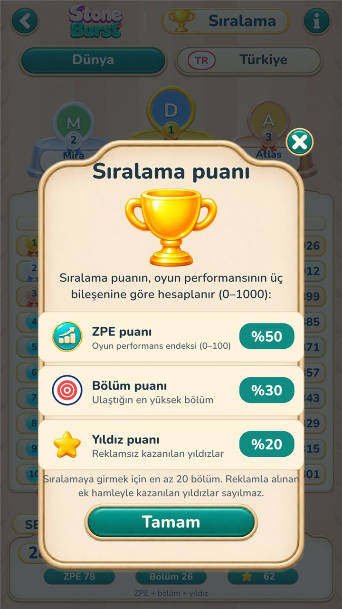

**Sıralama puanı (0–1000) = round(10 × (0,5 × ZPE + 0,3 × L + 0,2 × Y))**

| Bileşen | Ağırlık | Hesap |
|---|---|---|
| ZPE | %50 | 0–100 |
| L (bölüm) | %30 | Ulaşılan bölüm / 1000 × 100 |
| Y (yıldız) | %20 | Sıralama yıldızı / (3 × tamamlanan bölüm) × 100 |

- **Giriş şartı:** en az **20** tamamlanmış bölüm. Altında puan 0'dır ve kayıt yazılmaz.
- **Sıralama yıldızı:** normal bölümde **reklam yardımı olmadan** kazanılan en iyi yıldız. Günlük bulmaca yıldızları sayılmaz.
- **Kapsam:** Dünya ve Ülke. Ülke, cihazın bölge ayarından alınır.
- **Sunucu:** Firebase Firestore `scores/{uid}`. İlk 10 okunur. Oyuncunun sırası, kendinden yüksek puanlı oyuncu sayısı + 1'dir.
- **Hesap:** iOS'ta Game Center, Android'de Play Games ile giriş gerekir. Giriş yoksa "Sıralama için kayıt ol" düğmesi görünür.

---

## 19. Kayıt ve bulut

- **Cihazda:** her önemli anda (bölüm, yıldız, kalp, ayar) kayıt dosyasına yazılır. Önceki dosyanın `.bak` yedeği tutulur. Bölümün yarısı kaydedilmez.
- **Bulut** (Firestore `saves/{uid}`, Game Center / Play Games girişiyle):
  - Açılıştaki girişten sonra önce buluttaki kayıt okunur.
  - Bulut daha ilerideyse cihazdakinin yerine geçer. İlerleme sırası: tamamlanan bölüm, sonra yıldız, sonra açılan bölüm. Eski dosya `.precloud` olarak saklanır.
  - Okuma bitmeden buluta yazılmaz (yeni kurulum buluttakini ezmez).
  - Sonra her kazanılan bölümde (en çok 30 sn'de bir) ve uygulama arka plana geçince yazılır.
  - Ayarlar'daki **Kaydet** düğmesi de aynı kurala uyar.
- Ses ve titreşim ayarları cihazda kalır, buluta gitmez.

---

## 20. Öğretici turlar

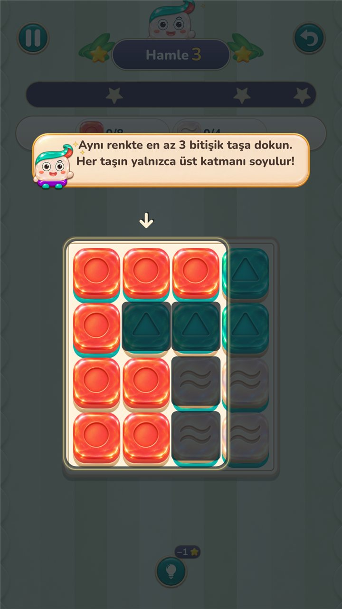

| Bölüm | Tur |
|---|---|
| 1 | Yönlendirmeli: 3+ grup dokunuşu. İlk hamleden sonra hedef kartı ve hamle sayacı tanıtılır. |
| 2 | Yönlendirmeli: zincir (domino) |
| 6 | Yönlendirmeli: 5+ grup → roket tepsiye |
| 9 | Yönlendirmeli: 8+ grup → Altın Rulo |
| 12 | Bilgi: tepside 4 yer var, biriktir |
| 21, 41, 61, 121, 201, 301, 401, 501, 601, 701 | Mekaniğin ilk bölümü: o hücre öne çıkarılır, kısa açıklama gösterilir |

- Yönlendirmeli turda yalnız gösterilen gruba dokunulabilir. Tur, bölüm kazanılınca bir daha gösterilmez.
- Bilgi adımları ilk gösterimden sonra kapanır.

---

## 21. Analytics olayları

Firebase Analytics (iOS ve Android). Kaynak: `S/Game/GameAnalytics.cs`.

| Olay | Parametreler | Ne zaman |
|---|---|---|
| `level_start` | level_number, level_id, kind, attempt, first_attempt | Oturum başında ve her yeniden başlatmada |
| `level_end` | + success, moves_used, move_limit, stars, assists | Oturum bitince (kazanma, kayıp, çıkış) |
| `ad_rewarded` | placement, outcome (rewarded / cancelled / failed) | Her ödüllü reklam sonucu |
| `ad_interstitial` | placement, shown | Geçiş reklamı denemesi |
| `hearts_empty` | level_number | Kalp yokken bölüm açılmak istenince |
| `review_prompt` | level_number, ask | Puan isteği |
| Kullanıcı özelliği `highest_level` | — | Normal bölüm kazanılınca |

Bu olaylarla ölçülebilecek temel metrikler:
- Bölüm başına başarı oranı ve deneme sayısı (`level_end.success`, `attempt`).
- Kullanılan / verilen hamle oranı.
- Yıldız dağılımı.
- Reklam izleme ve iptal oranı (yere göre).
- Kalpsiz kalma sıklığı.
- Oyuncu ilerlemesi (`highest_level`).

---

## 22. Metrik özeti (tek tablo)

| Konu | Değer |
|---|---|
| Bölüm sayısı | 1000 (10 bölge × 100) |
| Renk | 4 (bölüm başına 3–4) |
| En küçük grup | 3 taş, kenar komşuluğu |
| Roket / Altın Rulo | 5–7 / 8+ taşlık grup |
| Tepsi | 4 yuva, hamle harcamaz |
| Katman puanı | 10 × (1 + dalga) |
| Yıldız eşiği | 2. yıldız = 3. yıldız eşiğinin %75'i |
| Hamle limiti | 1–26 (ort. 11,9) |
| Kalp | 5, 30 dk'da 1, 21. bölümden itibaren |
| Günlük bulmaca | Reklamla giriş, 2 deneme, günde 1 kez yıldız, ödül +1 hamle |
| Reklamla devam | +1 hamle ve 1 taş, bölüm başına 1 |
| Reklamlı ipucu | −1 yıldız, deneme başına 1 |
| Geçiş reklamı | 11. bölümden sonra, 4 bölümde bir, ≥240 sn, oturumda ≤8 |
| ZPE ağırlıkları | Verim %35, zorluk %25, ilk deneme %20, hız %10, yardımsız %10 |
| Sıralama | ZPE %50 + bölüm %30 + yıldız %20, en az 20 bölüm |
| Koleksiyon | 22 taş (10 yıldız, 10 hazine, 2 efsanevi); hazineler şu an gizli |
| Deneme bölümleri | 10 |
| Dil | 9 |

---

## 23. Belgelerle çelişkiler ve açık noktalar

Kod ile eski belgeler (`docs/OYUN.md`, `docs/DURUM.md`) ve oyun içi metinler karşılaştırılırken bulundu.

**Oyunda görünen sorunlar** (2026-11-11'de düzeltildi; şu an incelemedeki 1.0.0 derlemelerinde yok, sonraki derlemeye girer)
1. **Günlük kartta prototip notu ve "(deneme)" yazısı:** not kaldırıldı, "(deneme)" eki 9 dilde silindi.
2. **Gizli hazine taşları kazanılamıyordu:** hazine bulma bölümlere bağlanana kadar koleksiyonda gösterilmiyor (`TreasuresAvailable = false`). Veri (`stones.json`) duruyor.
3. **Bağlı ataş öğretici metni:** 9 dilde "herhangi birinin yanında soyma yapman yeter" anlamına düzeltildi.
4. **ZPE paneli alt satırı:** kart kenarına taşmıyor.
- **Deneme Bölümleri** haritadan açılmıyor; bu bir hata değil, onaylı bir karar (KARARLAR, 2026-11-08 v8). Liste ve bölümler kodda duruyor.

**Eski belgelerdeki hatalar** (`docs/OYUN.md`)
5. "Bölüm 1–5: rulo" yazıyor. Doğrusu: 1–5'te rulo ve özel taş yok, ilk roket 6. bölümde. Rulo yalnız bölüm 296'da ve günlük bulmacalarda var.
6. "Kesin Hamle: limit = çözüm uzunluğu" yazıyor. Doğrusu: veride limit çözümden 0–12 fazla. "Kesin" motorda ayrı bir kural değil, yalnız kart metni.
7. "Öğretici 1–3 ve 7. bölüm" yazıyor. Doğrusu: yönlendirmeli turlar 1, 2, 6 ve 9.
8. "Kristal Koruma ilk 57. bölüm" yazıyor. Doğrusu: kristal ilk 60. bölümde (patron), tür olarak ilk 68'de.
9. "Patron her 10. bölüm, her 100. bölüm 3 kural" yazıyor. Doğrusu: 10 tane 10'un katı patron değil; 3 kural yalnız 600, 700 ve 800'de.
10. "TestUnlockAll = true" yazıyor (OYUN.md §10, DURUM.md). Kodda `false`.
11. Bazı kod yorumları ve DURUM.md'de "+3 hamle" geçiyor. Geçerli ödül +1 hamle ve 1 taş.

**Koddan doğrulanamayanlar** (üretim aracı `tools/LevelLab` içinde)
- Yıldız eşiklerinin hesap formülü (veride yalnız %75 oranı görülüyor).
- Bölüm türü takviminin ve günlük tür döngüsünün formülü (veriden çıkarıldı).
- "Her üç bölümde bir ortası boş tahta" kuralı.
